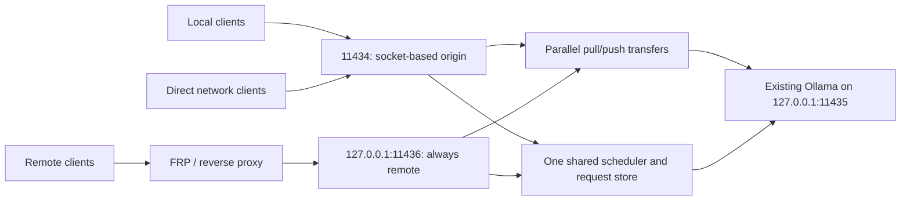

[English](README.md) | [简体中文](docs/README.zh-CN.md) | [日本語](docs/README.ja.md) | [한국어](docs/README.ko.md) | [Deutsch](docs/README.de.md) | [Français](docs/README.fr.md) | [Español](docs/README.es.md)

# Ollama Status Service

**Know when your Ollama machine can accept work — and give local users the next turn.**

A Windows gateway, background service and system tray application for an existing Ollama installation. It tracks requests as they execute, exposes machine-readable status and help, and schedules local and remote work through one shared queue.

**Current release: 1.2.5 · Windows x64 · Offline installer**

Version 1.2.5 fixes empty model lists caused by missing LocalService permissions. Installation and upgrade repair model-tree permissions, verify access using the actual service account, and check backend/gateway model inventories before reporting success. The default C-drive user-profile model directory is supported. The concurrent `pull`/`push` fix from 1.2.4 is retained.

[Download 1.2.5](https://github.com/ozil56/OllamaStatusService/releases/tag/v1.2.5) · [Release notes](CHANGELOG.md) · [Build from source](docs/BUILD.md)

> Download `OllamaStatusService-Windows-x64-v1.2.5.zip` from the release assets. GitHub's automatic “Source code” archives are not installable packages. The installer and tray interface currently use Simplified Chinese; these README translations do not change the application language.

## Why a gateway?

An installed or loaded model is not necessarily busy. `/api/tags` lists models and `/api/ps` lists loaded models; neither is a request scheduler. This service observes the requests it forwards, including streaming responses, disconnects and uncertain completion.

All managed requests must pass through the gateway. Direct access to the underlying Ollama port is outside its accounting. This project is independent of Ollama and does not bundle Ollama, models, GPU libraries or drivers.

## Highlights

- **Reliable state:** `idle`, `busy`, `offline`, `unknown` and `stopping`; active and queued request counts, origin and IDs.
- **Local priority without preemption:** an active request finishes first; waiting local requests precede waiting remote requests, with FIFO within each class. No reservation for future batches.
- **Dedicated proxy ingress:** FRP, SSH tunnels and reverse proxies use `11436`, always classified as `remote`. Client-supplied headers cannot promote a request to `local`.
- **Self-describing API:** `/help`, `/.well-known/ollama-status-service` and `/openapi.json` describe capabilities, queue limits and retry rules.
- **Useful tray feedback:** colored symbols, queue counts, dashboard, logs and service controls. Closing the tray does not stop the background services.
- **Practical installer:** model-path discovery with provenance, package integrity checks, upgrade preflight and a single progress window.
- **Conservative recovery:** uncertain execution is persisted in SQLite and blocks new work until recovery. Full prompts and generated responses are not stored in the request database.

| Tray | Meaning |
| --- | --- |
|  | Idle |
|  | Busy / requests queued |
|  | Backend unavailable |
|  | Completion uncertain; recovery required |

## Architecture



| Port | Default role | Origin |
| --- | --- | --- |
| `11434` | IPv4/IPv6 direct gateway | Real socket peer; use loopback for local clients |
| `11436` | IPv4 loopback proxy ingress | Always `remote` |
| `11435` | IPv4 loopback Ollama backend | Internal only; do not bypass the gateway |

The two gateway listeners share one process, lifecycle, execution limit and queue. This is request-level scheduling, not distributed GPU memory. Multi-machine selection remains the client's responsibility; a standard-library example is in [`examples/route_request.py`](examples/route_request.py).

## Install or upgrade

Requirements: Windows 10/11 x64 or Windows Server with a desktop, an existing Ollama installation and local models, Windows PowerShell 5.1, .NET Framework 4.8, and administrator access for installation. Task Scheduler and Windows Firewall management must be available.

1. Download the release ZIP and its `.sha256.txt`. Verify the ZIP with `Get-FileHash -Algorithm SHA256` and compare it with the supplied checksum.
2. Pause new submissions and let running and queued work finish. Extract the **whole** archive to a new folder, outside the installed program directory.
3. Run **`安装.exe`** (Install). Check the detected Ollama executable and model directory, then approve the Windows UAC prompt. For an existing installation, the same executable offers the upgrade flow.
4. Open the tray icon, or visit `http://127.0.0.1:11434/dashboard`. The runtime, dependencies and service wrapper are bundled; installation does not download them.
5. For FRP or another same-machine proxy, migrate its local destination to `127.0.0.1:11436`, then verify origin before resuming clients.

The installer reuses your existing Ollama and models, changes the backend to `11435`, and installs gateway/backend services. Installation, upgrades, recovery and stopping services can interrupt work: **non-preemption applies to normal scheduling, not maintenance**. Upgrade checks reject busy/queued/unknown state and proxy-port conflicts before uninstalling. If installation fails after uninstalling the old version, the installer reports the error and retains backups; it does not promise automatic rollback.

Run **`卸载.exe`** (Uninstall) to remove this service and restore backed-up integration settings. The original Ollama installation and models are retained. Detailed Chinese instructions: [deployment guide](部署说明.txt), [AI integration guide](AI接入说明.txt).

Model permissions are granted only to **LocalService (`S-1-5-19`)** with **Modify**, including protected child directories/files. Original rules are recorded before changes and restored on uninstall or failed installation; unrelated accounts, ownership and inheritance protection are retained. A temporary task tests real service-account access and is removed after the check. Explicit denies/encryption can still block access and produce a path-specific error. Model-tree junctions/reparse points are rejected; select the actual directory instead.

## FRP migration in 1.2.3

For the existing Ollama proxy entry on **each server**, change only the local destination:

```toml
localIP = "127.0.0.1"
localPort = 11436
```

For INI configurations, use `local_ip` and `local_port`. Preserve the existing proxy name, type, public port/domain, authentication and TLS configuration. External client URLs normally stay the same. Examples are configuration fragments, not replacement files: [`frpc-ollama.toml`](examples/frpc-ollama.toml), [`frpc-ollama.ini`](examples/frpc-ollama.ini).

Nginx, Caddy and SSH tunnels on the same machine should also target `11436`. An off-machine proxy requires an explicit reachable bind address and appropriately restricted firewall access. The ingress accepts ordinary HTTP, **not PROXY protocol**.

```powershell
curl.exe --noproxy "*" http://127.0.0.1:11434/help
curl.exe --noproxy "*" http://127.0.0.1:11436/help
```

Check `version=1.2.5` and `request_origin=local` / `remote` respectively, then check `/help` through the existing public proxy URL. During inference, inspect `/status.active_origin` and `requests[].origin`. If the proxy still targets `11434`, loopback forwarding can still be mistaken for local work.

Acceptance sequence: run remote A, queue remote B, then queue local C with a positive wait timeout. A must finish uninterrupted; C runs before B. Both queued requests must remain within their wait deadline and queue capacity.

## API and queue policy

| Endpoint | Purpose |
| --- | --- |
| `GET /status` | Current state, readiness, active/queued counts and request metadata |
| `GET /help` | Live limits, capabilities, origin and client guidance |
| `GET /healthz` | Gateway liveness and this probe's origin; not proof of backend readiness |
| `GET /dashboard` | Browser status panel |
| `GET /api/tags`, `GET /api/ps` | Proxied Ollama model inventory / loaded models |

Use `X-Ollama-Queue-Timeout` per inference request: `0` declines immediately when busy, a positive number waits up to that many seconds, and omission uses the server default (15 seconds). The default maximum is 3600 seconds; read `/help` for the running instance's limits. Waiting deadlines do not cut off inference once it has started. Scheduled execution concurrency is 1 (excluding pull/push), with up to 64 queued requests and 64 MiB of queued JSON data.

```powershell
$body = @{ model='qwen3:8b'; prompt='Hello'; stream=$false } | ConvertTo-Json
Invoke-RestMethod -Uri 'http://127.0.0.1:11434/api/generate' `
  -Method Post -ContentType 'application/json; charset=utf-8' `
  -Headers @{'X-Ollama-Queue-Timeout'='30'} `
  -Body ([Text.Encoding]::UTF8.GetBytes($body)) -TimeoutSec 3700
```

Replace the model with one installed locally. A local request only gains priority **after actually joining the queue**. Zero-wait requests can be refused while busy; a continuous local workload can delay remote work until its deadline expires.

`can_start_now` is a snapshot, not a reservation. Safe automatic failover requires **HTTP 429/503 + `X-Ollama-Forwarded: false` + JSON `forwarded: false`**. Timeouts, disconnects or partial output do not prove that execution never began; do not silently replay uncertain requests on another machine. The service does not provide cross-server exactly-once execution.

## Network and recovery boundaries

**The gateway adds no authentication.** Since 1.2.2, installation/upgrade sets this product's TCP `11434` allow rule to any source, any local address and any network profile, restricted to the bundled Python program. Earlier custom source restrictions are backed up but not automatically retained. Review the rule after upgrading and enforce appropriate authentication, HTTPS and network controls. `11435` and `11436` default to loopback and are not automatically opened externally.

Persistent configuration and history live under `%ProgramData%\OllamaStatusService`; application files live under `%ProgramFiles%\OllamaStatusService`. See [`config.example.json`](config.example.json). No remote configuration-write API is provided.

If a request's completion cannot be verified, `unknown` blocks further admissions. Use the tray's recovery action only when terminating unfinished work is acceptable. Recovery stops and checks the backend before clearing uncertain records. Do not delete the database while Ollama may still be running. Queued payloads are in memory and are not replayed after restart.

## Development and validation

See [build instructions](docs/BUILD.md) for test commands. Version 1.2.5 validation covers 68 Python tests, 13 isolated upgrade scenarios, real NTFS ACL repair and LocalService access checks in a C-drive user-profile fixture, plus package/configuration checks. The earlier reports retain the two concurrent Ollama CLI checks from 1.2.4 and the 1.2.3 installer UI checks. Tests do not prove deployment or GPU/FRP behavior on every production server. See [validation report](验证报告.txt).

Public examples use placeholders. Production configurations, logs and the original client/development Word and Markdown documents are intentionally excluded.

## License

No project source-code license has been selected yet. Publication does not grant a general license to use, modify or redistribute the project source. Third-party notices do not license this project’s own code.

Third-party components retain their own licenses; see [`licenses/THIRD-PARTY-NOTICES.txt`](licenses/THIRD-PARTY-NOTICES.txt). The release carries the Python and vendored dependency license files.
