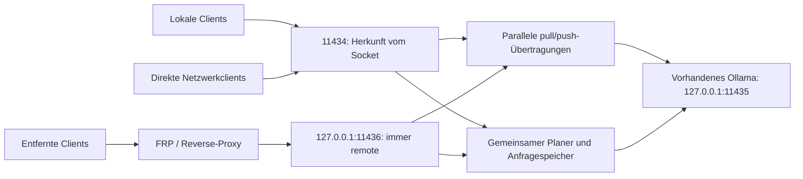

[English](../README.md) | [简体中文](README.zh-CN.md) | [繁體中文](README.zh-TW.md) | [日本語](README.ja.md) | [한국어](README.ko.md) | [Deutsch](README.de.md) | [Français](README.fr.md) | [Español](README.es.md)

<!-- readme:b00 -->

# Ollama Status Service

<!-- readme:b01 -->

**Erkennen, wann Ihr Ollama-Rechner Arbeit annehmen kann – und lokalen Nutzern den nächsten freien Platz geben.**

<!-- readme:b02 -->

Ein Windows-Gateway mit Hintergrunddiensten und einer Tray-Anwendung für eine vorhandene Ollama-Installation. Es verfolgt die Ausführung von Anfragen, stellt maschinenlesbare Status- und Hilfeinformationen bereit und plant lokale sowie entfernte Arbeit über eine gemeinsame Warteschlange.

<!-- readme:b03 -->

**Aktuelle Version: 1.6.1 · Windows x64 · Offline-Installer**

<!-- readme:b04 -->

Version 1.6.1 behebt gemischte Sprachen in Versionsanzeigen, gespeicherten Update-Verläufen und Abschlussmeldungen des Installers. Enthalten sind acht UI-Sprachen mit automatischer Zuordnung und gespeicherter Auswahl, automatische Proxy-Erkennung und eine integrierte lokale Download-Weiterleitung für TUN/Fake-IP-Netze. Veraltete Ollama-Update-Angebote und kurz aufblitzende Konsolenfenster bei Tray-Aktionen wurden behoben. Siehe [Download-Netzwerk][link1]. Das Tray kann außerdem offizielle Ollama-Updates prüfen und installieren: Alle sechs Stunden wird nach stabilen Versionen gesucht, Hash und Herausgebersignatur des Installers werden geprüft, laufende oder unklare Arbeit wird nicht unterbrochen, und nach Prüfung der ursprünglichen Modelle und Konfiguration übernimmt OSS wieder die Verwaltung. Siehe [Ollama-Updates][link2]. Das Windows-Paket ist unten verlinkt.

<!-- readme:b05 -->

Seit 1.4.0 ist unter `/manage` eine Webverwaltung für mehrere Server integriert: Knoten hinzufügen/importieren, Modelle herunterladen/löschen und dauerhaft vom Server verwaltete Downloads pausieren/fortsetzen. Die vorhandene Reverse-Proxy-Authentifizierung bleibt bestehen; zusätzliche Konten, Ports oder Verwaltungsprozesse sind nicht nötig. Siehe [Verwaltungsanleitung][link3].

<!-- readme:b06 -->

Version 1.2.5 behebt leere Modelllisten durch fehlende LocalService-Berechtigungen. Installation und Upgrade reparieren die Rechte im Modellverzeichnis, prüfen den Zugriff mit dem tatsächlichen Dienstkonto und vergleichen Backend- und Gateway-Modelllisten, bevor Erfolg gemeldet wird. Das Standard-Modellverzeichnis im Benutzerprofil auf C: wird unterstützt. Die Korrektur paralleler `pull`/`push`-Vorgänge aus 1.2.4 bleibt enthalten.

<!-- readme:b07 -->

[Release 1.6.1][link4] · [Windows-ZIP][link5] · [SHA256][link6] · [Änderungen][link7] · [Aus Quellcode bauen][link8]

<!-- readme:b08 -->

> Laden Sie `OllamaStatusService-Windows-x64-v1.6.1.zip` und die Prüfsumme aus dem oben verlinkten Release herunter oder bauen Sie das Paket selbst. GitHubs automatisch erzeugte „Source code“-Archive sind keine Installationspakete. Installer, Tray, /manage und /dashboard unterstützen vereinfachtes und traditionelles Chinesisch, Englisch, Japanisch, Koreanisch, Deutsch, Französisch und Spanisch. Automatische Spracherkennung und gespeicherte manuelle Auswahl sind verfügbar; /status und /help übersetzen Anzeigetexte und behalten die Protokollfelder bei. Siehe [Sprachen][link9].

<!-- readme:b09 -->

Modellübertragungen mit `pull`/`push` umgehen die Inferenzwarteschlange und deren Zeitlimits, können parallel laufen und streamen weiterhin ihren Fortschritt. `/status` zählt sie separat: Für Wartungszwecke setzen sie den Zustand auf `busy`, ohne einen Inferenzplatz zu belegen. Für die Inferenzbereitschaft gilt `can_start_now`.

<!-- readme:b10 -->

## Warum ein Gateway?

<!-- readme:b11 -->

Ein installiertes oder geladenes Modell ist nicht zwangsläufig beschäftigt. `/api/tags` listet Modelle und `/api/ps` geladene Modelle auf; beide sind keine Anfrageplaner. Dieser Dienst beobachtet die weitergeleiteten Anfragen einschließlich Streaming-Antworten, Verbindungsabbrüchen und unklarem Abschluss.

<!-- readme:b12 -->

Alle verwalteten Anfragen müssen das Gateway passieren. Direkter Zugriff auf den darunterliegenden Ollama-Port wird nicht erfasst. Dieses Projekt ist unabhängig von Ollama und enthält weder Ollama noch Modelle, GPU-Bibliotheken oder Treiber.

<!-- readme:b13 -->

## Funktionen

<!-- readme:b14 -->

- **Verlässlicher Zustand:** `idle`, `busy`, `offline`, `unknown` und `stopping` sowie Anzahl, Herkunft und IDs aktiver und wartender Anfragen.
- **Lokaler Vorrang ohne Verdrängung:** Die aktive Anfrage endet zuerst; wartende lokale Anfragen stehen vor entfernten, innerhalb jeder Klasse gilt FIFO. Keine Reservierung für zukünftige Stapel.
- **Eigener Proxy-Eingang:** FRP, SSH-Tunnel und Reverse-Proxys verwenden `11436` und gelten immer als `remote`. Client-Header können eine Anfrage nicht zu `local` aufwerten.
- **Selbstbeschreibende API:** `/help`, `/.well-known/ollama-status-service` und `/openapi.json` erläutern Fähigkeiten, Warteschlangenlimits und Wiederholungsregeln.
- **Nützliche Tray-Rückmeldungen:** Farbsymbole, Warteschlangenzähler, Dashboard, Protokolle und Dienststeuerung. Das Schließen des Trays beendet keine Hintergrunddienste.
- **Praktischer Installer:** Modellpfaderkennung mit Herkunftsangabe, Paketprüfung, Upgrade-Vorabprüfung und ein gemeinsames Fortschrittsfenster.
- **Vorsichtige Wiederherstellung:** Unklare Ausführungen werden in SQLite gespeichert und blockieren neue Arbeit bis zur Wiederherstellung. Vollständige Prompts und generierte Antworten werden nicht in der Anfragedatenbank gespeichert.

<!-- readme:b15 -->

| Tray | Bedeutung |
| --- | --- |
| ![Frei][link10] | Frei |
| ![Beschäftigt][link11] | Beschäftigt / Anfragen warten |
| ![Offline][link12] | Backend nicht verfügbar |
| ![Unklar][link13] | Abschluss unklar; Wiederherstellung erforderlich |

<!-- readme:b16 -->

## Architektur

<!-- readme:b17 -->



<!-- readme:b18 -->

| Port | Standardaufgabe | Herkunft |
| --- | --- | --- |
| `11434` | Direkter IPv4/IPv6-Gateway-Zugang | Tatsächlicher Socket-Gegenpart; lokale Clients verwenden Loopback |
| `11436` | IPv4-Loopback-Proxy-Eingang | Immer `remote` |
| `11435` | Ollama-Backend auf IPv4-Loopback | Nur intern; das Gateway nicht umgehen |

<!-- readme:b19 -->

Beide Gateway-Listener teilen einen Prozess, Lebenszyklus, Ausführungslimit und Warteschlange. Dies ist Planung einzelner Anfragen, kein verteilter GPU-Speicher. Die Auswahl zwischen mehreren Rechnern bleibt Aufgabe des Clients; ein Beispiel nur mit Standardbibliothek steht in [`examples/route_request.py`][link14].

<!-- readme:b20 -->

## Installation oder Upgrade

<!-- readme:b21 -->

Voraussetzungen: Windows 10/11 x64 oder Windows Server mit Desktop, vorhandenes Ollama und lokale Modelle, Windows PowerShell 5.1, .NET Framework 4.8 sowie Administratorrechte für die Installation. Aufgabenplanung und Windows-Firewall-Verwaltung müssen verfügbar sein.

<!-- readme:b22 -->

1. Release-ZIP und `.sha256.txt` herunterladen. Das ZIP mit `Get-FileHash -Algorithm SHA256` prüfen und mit der mitgelieferten Prüfsumme vergleichen.
2. Neue Aufträge pausieren und laufende sowie wartende Arbeit abschließen lassen. Das **gesamte** Archiv in einen neuen Ordner außerhalb des installierten Programmverzeichnisses entpacken.
3. **`Install.exe`** starten, erkannte Ollama-Datei und Modellverzeichnis prüfen und die Windows-UAC-Abfrage bestätigen. Bei vorhandener Installation bietet dasselbe Programm das Upgrade an.
4. Das Tray-Symbol öffnen oder `http://127.0.0.1:11434/dashboard` aufrufen. Laufzeit, Abhängigkeiten und Dienst-Wrapper sind enthalten; die Installation lädt sie nicht herunter.
5. Bei FRP oder einem anderen lokalen Proxy das lokale Ziel auf `127.0.0.1:11436` umstellen und die Herkunft prüfen, bevor Clients wieder Anfragen senden.

<!-- readme:b23 -->

Der Installer verwendet vorhandenes Ollama und Modelle, verlegt das Backend auf `11435` und installiert Gateway- und Backend-Dienste. Installation, Upgrade, Wiederherstellung und Dienststopp können Arbeit unterbrechen: **Nichtverdrängung gilt für normale Planung, nicht für Wartung**. Die Upgrade-Vorabprüfung lehnt beschäftigte, wartende oder unklare Zustände und Proxy-Portkonflikte vor der Deinstallation ab. Scheitert die Installation nach Entfernung der alten Version, meldet der Installer den Fehler und behält Sicherungen; ein automatisches Rollback wird nicht zugesichert.

<!-- readme:b24 -->

**`Uninstall.exe`** entfernt diesen Dienst und stellt gesicherte Integrationseinstellungen wieder her. Die ursprüngliche Ollama-Installation und Modelle bleiben erhalten. Ausführliche chinesische Anleitungen: [Bereitstellung][link15] und [KI-Integration][link16].

<!-- readme:b25 -->

Modellberechtigungen werden ausschließlich **LocalService (`S-1-5-19`)** als **Ändern (Modify)** erteilt, einschließlich geschützter Unterverzeichnisse und Dateien. Originalregeln werden vorher aufgezeichnet und bei Deinstallation oder fehlgeschlagener Installation wiederhergestellt; andere Konten, Eigentümer und Vererbungsschutz bleiben erhalten. Eine temporäre Aufgabe prüft den tatsächlichen Dienstkontozugriff und wird danach entfernt. Explizite Verweigerungen oder Verschlüsselung können weiterhin blockieren und einen pfadbezogenen Fehler auslösen. Junctions und Reparse Points im Modellbaum werden abgelehnt; wählen Sie das tatsächliche Verzeichnis.

<!-- readme:b26 -->

## FRP und Reverse-Proxy einrichten

<!-- readme:b27 -->

Ändern Sie im vorhandenen Ollama-Proxy-Eintrag auf **jedem Server** nur das lokale Ziel:

<!-- readme:b28 -->

```toml
localIP = "127.0.0.1"
localPort = 11436
```

<!-- readme:b29 -->

Bei INI heißen die Felder `local_ip` und `local_port`. Proxy-Name, Typ, öffentlicher Port/Domain, Authentifizierung und TLS bleiben erhalten. Externe Client-URLs ändern sich normalerweise nicht. Die Beispiele sind Konfigurationsfragmente, keine Ersatzdateien: [`frpc-ollama.toml`][link17], [`frpc-ollama.ini`][link18].

<!-- readme:b30 -->

Nginx, Caddy und SSH-Tunnel auf demselben Rechner sollen ebenfalls `11436` verwenden. Ein Proxy auf einem anderen Rechner benötigt eine ausdrücklich konfigurierte erreichbare Bind-Adresse und passend eingeschränkte Firewall-Freigaben. Der Eingang akzeptiert normales HTTP, **kein PROXY protocol**.

<!-- readme:b31 -->

```powershell
curl.exe --noproxy "*" http://127.0.0.1:11434/help
curl.exe --noproxy "*" http://127.0.0.1:11436/help
```

<!-- readme:b32 -->

Prüfen Sie `version=1.6.1` und jeweils `request_origin=local` / `remote`, anschließend `/help` über die vorhandene öffentliche Proxy-URL. Während der Inferenz prüfen Sie `/status.active_origin` und `requests[].origin`. Zeigt der Proxy weiterhin auf `11434`, kann Loopback-Weiterleitung weiterhin irrtümlich als lokale Arbeit gelten.

<!-- readme:b33 -->

Abnahmefolge: Entfernte Anfrage A ausführen, entfernte B einreihen und danach lokale C mit positiver Wartefrist einreihen. A muss ohne Unterbrechung enden; C wird vor B ausgeführt. Beide wartenden Anfragen müssen ihre Wartefrist und die Warteschlangenkapazität einhalten.

<!-- readme:b34 -->

## API und Warteschlangenregeln

<!-- readme:b35 -->

| Endpunkt | Zweck |
| --- | --- |
| `GET /status` | Zustand, Bereitschaft, aktive/wartende Anzahl und Anfragemetadaten |
| `GET /help` | Aktuelle Limits, Fähigkeiten, Herkunft und Client-Hinweise |
| `GET /healthz` | Gateway-Erreichbarkeit und Herkunft dieser Probe; kein Beleg für Backend-Bereitschaft |
| `GET /dashboard` | Statusanzeige im Browser |
| `GET /manage` | Integrierte Server- und Modellverwaltung mit vorhandener Reverse-Proxy-Authentifizierung |
| `GET /api/tags`, `GET /api/ps` | Weitergeleitete Ollama-Modellliste / geladene Modelle |

<!-- readme:b36 -->

Setzen Sie pro Inferenzanfrage `X-Ollama-Queue-Timeout`: `0` lehnt bei Auslastung sofort ab, ein positiver Wert wartet höchstens diese Anzahl Sekunden, ohne Header gilt der Serverstandard (15 Sekunden). Das Standardmaximum beträgt 3600 Sekunden; aktuelle Instanzlimits stehen in `/help`. Eine gestartete Inferenz wird nicht durch die Wartefrist beendet. Die geplante Ausführungsparallelität beträgt 1 (ohne pull/push), mit höchstens 64 wartenden Anfragen und 64 MiB wartenden JSON-Daten.

<!-- readme:b37 -->

```powershell
$body = @{ model='qwen3:8b'; prompt='Hello'; stream=$false } | ConvertTo-Json
Invoke-RestMethod -Uri 'http://127.0.0.1:11434/api/generate' `
  -Method Post -ContentType 'application/json; charset=utf-8' `
  -Headers @{'X-Ollama-Queue-Timeout'='30'} `
  -Body ([Text.Encoding]::UTF8.GetBytes($body)) -TimeoutSec 3700
```

<!-- readme:b38 -->

Ersetzen Sie das Beispielmodell durch ein lokal installiertes Modell. Lokaler Vorrang entsteht erst **nach dem tatsächlichen Einreihen**. Anfragen ohne Wartezeit können bei Auslastung abgelehnt werden; dauerhafte lokale Last kann entfernte Arbeit bis zum Ablauf ihrer Frist verzögern.

<!-- readme:b39 -->

`can_start_now` ist eine Momentaufnahme, keine Reservierung. Sicheres automatisches Ausweichen erfordert **HTTP 429/503 + `X-Ollama-Forwarded: false` + JSON `forwarded: false` gemeinsam**. Zeitüberschreitungen, Verbindungsabbrüche oder Teilausgaben beweisen nicht, dass die Ausführung nie begonnen hat; unklare Anfragen dürfen nicht stillschweigend auf einem anderen Rechner wiederholt werden. Der Dienst garantiert keine serverübergreifende Exactly-once-Ausführung.

<!-- readme:b40 -->

## Netzwerk- und Wiederherstellungsgrenzen

<!-- readme:b41 -->

**Das Gateway fügt keine Authentifizierung hinzu.** Seit 1.2.2 setzt Installation/Upgrade die produktspezifische TCP-`11434`-Freigabe auf alle Quellen, lokalen Adressen und Netzwerkprofile, beschränkt auf das mitgelieferte Python-Programm. Frühere Quellbeschränkungen werden gesichert, aber nicht automatisch beibehalten. Prüfen Sie die Regel nach einem Upgrade und sorgen Sie für passende Authentifizierung, HTTPS und Netzwerkkontrollen. `11435` und `11436` sind standardmäßig auf Loopback beschränkt und werden nicht automatisch extern geöffnet.

<!-- readme:b42 -->

Persistente Konfiguration und Verlauf liegen unter `%ProgramData%\OllamaStatusService`, Programmdateien unter `%ProgramFiles%\OllamaStatusService`. Siehe [`config.example.json`][link19]. Eine API zum entfernten Schreiben der Konfiguration ist nicht vorgesehen.

<!-- readme:b43 -->

Ist der Abschluss einer Anfrage nicht verifizierbar, blockiert `unknown` weitere Annahmen. Verwenden Sie die Tray-Wiederherstellung nur, wenn das Beenden unfertiger Arbeit akzeptabel ist. Sie stoppt und prüft das Backend, bevor unklare Datensätze gelöscht werden. Löschen Sie die Datenbank nicht, während Ollama möglicherweise noch läuft. Wartende Nutzdaten liegen im Arbeitsspeicher und werden nach einem Neustart nicht wiederholt.

<!-- readme:b44 -->

## Entwicklung und Validierung

<!-- readme:b45 -->

Testbefehle stehen in der [Build-Anleitung][link8]. Version 1.6.1 bestand 18 native Lokalisierungsprüfungen, 11 Web-Lokalisierungsprüfungen, 18 isolierte OSS-Upgradeszenarien, 21 Tray-/Release-Prüfungen, 12 Ollama-Update-Koordinatorszenarien samt weiteren Wiederherstellungsprüfungen, vier echte Installer-GUI-Prüfungen und fünf Prüfungen kompilierter versteckter Worker. Der vorherige 1.6.0-Integrationslauf bestand 118 Python-Tests, darunter 15 Download-Netzwerk- und sieben Upgrade-Zulassungsprüfungen. Paket-Hashes, Archivintegrität, ASCII-Dateinamen und Übereinstimmung von Quellcode und Paket werden vor Veröffentlichung geprüft. Version 1.2.5 prüfte zusätzlich echte NTFS-ACL-Reparaturen und LocalService-Zugriff in einem Benutzerprofil-Testverzeichnis auf C:. Frühere Berichte enthalten die zwei parallelen Ollama-CLI-Prüfungen aus 1.2.4 und die Installer-UI-Prüfungen aus 1.2.3. Tests beweisen keine korrekte Bereitstellung oder GPU-/FRP-Funktion auf jedem Produktionsserver. Siehe [Prüfbericht][link20].

<!-- readme:b46 -->

Alle acht README-Ausgaben enthalten dieselben Abschnitte, Tabellen, Beispiele und Betriebsgrenzen. Sie werden aus gemeinsamen Übersetzungsblöcken erzeugt; fehlende oder veraltete Ausgaben verhindern die Paketerstellung. Siehe [Pflege der README-Übersetzungen][link21].

<!-- readme:b47 -->

Öffentliche Beispiele verwenden Platzhalter. Produktionskonfigurationen, Protokolle und ursprüngliche Client-/Entwicklungsdokumente in Word und Markdown sind bewusst ausgeschlossen.

<!-- readme:b48 -->

## Lizenz

<!-- readme:b49 -->

Für den Projektquellcode wurde noch keine Lizenz ausgewählt. Die Veröffentlichung erteilt keine allgemeine Erlaubnis zur Nutzung, Änderung oder Weiterverbreitung des Quellcodes. Hinweise zu Drittanbieter-Lizenzen lizenzieren nicht den eigenen Code dieses Projekts.

<!-- readme:b50 -->

Drittanbieter-Komponenten behalten ihre jeweiligen Lizenzen; siehe [`licenses/THIRD-PARTY-NOTICES.txt`][link22]. Das Release enthält die Lizenzdateien von Python und den mitgelieferten Abhängigkeiten.

[link1]: ../docs/DOWNLOAD-NETWORK.md
[link2]: ../docs/OLLAMA-UPDATES.md
[link3]: ../docs/MANAGE.md
[link4]: https://github.com/ozil56/OllamaStatusService/releases/tag/v1.6.1
[link5]: https://github.com/ozil56/OllamaStatusService/releases/download/v1.6.1/OllamaStatusService-Windows-x64-v1.6.1.zip
[link6]: https://github.com/ozil56/OllamaStatusService/releases/download/v1.6.1/OllamaStatusService-Windows-x64-v1.6.1.zip.sha256.txt
[link7]: ../CHANGELOG.md
[link8]: ../docs/BUILD.md
[link9]: ../docs/LANGUAGES.md
[link10]: ../docs/images/idle.png
[link11]: ../docs/images/busy.png
[link12]: ../docs/images/offline.png
[link13]: ../docs/images/unknown.png
[link14]: ../examples/route_request.py
[link15]: ../Deployment-Guide.txt
[link16]: ../Integration-Guide.txt
[link17]: ../examples/frpc-ollama.toml
[link18]: ../examples/frpc-ollama.ini
[link19]: ../config.example.json
[link20]: ../Verification-Report.txt
[link21]: ../docs/README-TRANSLATIONS.md
[link22]: ../licenses/THIRD-PARTY-NOTICES.txt
