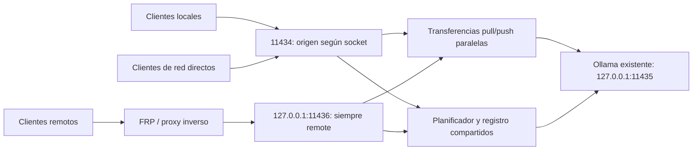

[English](../README.md) | [简体中文](README.zh-CN.md) | [繁體中文](README.zh-TW.md) | [日本語](README.ja.md) | [한국어](README.ko.md) | [Deutsch](README.de.md) | [Français](README.fr.md) | [Español](README.es.md)

<!-- readme:b00 -->

# Ollama Status Service

<!-- readme:b01 -->

**Sepa cuándo su equipo Ollama puede aceptar trabajo y dé a los usuarios locales el siguiente turno.**

<!-- readme:b02 -->

Una pasarela de Windows, servicios en segundo plano y una aplicación de bandeja para una instalación existente de Ollama. Sigue la ejecución de las solicitudes, ofrece estado y ayuda legibles por máquinas y organiza el trabajo local y remoto mediante una cola compartida.

<!-- readme:b03 -->

**Versión actual: 1.6.1 · Windows x64 · Instalador sin conexión**

<!-- readme:b04 -->

La versión 1.6.1 corrige la mezcla de idiomas en los resúmenes de versión, el historial de actualizaciones y los mensajes de instalación finalizada. Incluye ocho idiomas de interfaz con detección automática y selección guardada, detección automática de proxies y un relé local de descarga integrado para redes TUN/Fake-IP. Corrige avisos obsoletos de actualización de Ollama y ventanas de consola que aparecían brevemente al usar la bandeja. Consulte [la red de descarga][link1]. La bandeja también comprueba e instala actualizaciones oficiales de Ollama: busca versiones estables cada seis horas, verifica el hash y la firma del editor del instalador, rechaza interrumpir trabajos activos o inciertos y devuelve el control a OSS después de validar los modelos y la configuración originales. Consulte [las actualizaciones de Ollama][link2]. El paquete de Windows está enlazado abajo.

<!-- readme:b05 -->

Desde 1.4.0, `/manage` integra un gestor web de varios servidores: añadir/importar nodos, descargar/eliminar modelos y pausar/reanudar descargas persistentes gestionadas por el servidor. Utiliza la autenticación del proxy inverso existente, sin cuentas, puertos ni procesos de gestión adicionales. Consulte [la guía de gestión][link3].

<!-- readme:b06 -->

La versión 1.2.5 corrige listas vacías de modelos debidas a permisos insuficientes de LocalService. La instalación y actualización reparan los permisos del árbol de modelos, comprueban el acceso con la cuenta de servicio real y comparan los inventarios del backend y de la pasarela antes de informar de éxito. Se admite la carpeta predeterminada de modelos del perfil de usuario en C:. Se mantiene la corrección de transferencias simultáneas `pull`/`push` de 1.2.4.

<!-- readme:b07 -->

[Versión 1.6.1][link4] · [ZIP de Windows][link5] · [SHA256][link6] · [Cambios][link7] · [Compilar desde el código][link8]

<!-- readme:b08 -->

> Descargue `OllamaStatusService-Windows-x64-v1.6.1.zip` y su suma de comprobación desde la publicación anterior, o compílelo desde el código fuente. Los archivos «Source code» generados automáticamente por GitHub no son instaladores. El instalador, la bandeja, /manage y /dashboard admiten chino simplificado y tradicional, inglés, japonés, coreano, alemán, francés y español. Puede detectar el idioma automáticamente o guardar una selección manual; /status y /help traducen el texto visible y mantienen las claves del protocolo. Consulte [los idiomas][link9].

<!-- readme:b09 -->

Las transferencias de modelos `pull`/`push` evitan la cola de inferencia y sus tiempos de espera, pueden ejecutarse simultáneamente y mantienen el flujo de progreso. `/status` las cuenta por separado: establecen el estado de mantenimiento en `busy` sin ocupar un puesto de inferencia. Use `can_start_now` para conocer la disponibilidad de inferencia.

<!-- readme:b10 -->

## ¿Por qué una pasarela?

<!-- readme:b11 -->

Un modelo instalado o cargado no está necesariamente ocupado. `/api/tags` enumera modelos y `/api/ps` modelos cargados; ninguno organiza las solicitudes. Este servicio observa las solicitudes que reenvía, incluidas respuestas en flujo, desconexiones y finalizaciones inciertas.

<!-- readme:b12 -->

Todas las solicitudes gestionadas deben pasar por la pasarela. El acceso directo al puerto subyacente de Ollama queda fuera de su seguimiento. Este proyecto es independiente de Ollama y no incluye Ollama, modelos, bibliotecas GPU ni controladores.

<!-- readme:b13 -->

## Funciones destacadas

<!-- readme:b14 -->

- **Estado fiable:** `idle`, `busy`, `offline`, `unknown` y `stopping`, con número, origen e identificadores de solicitudes activas y en cola.
- **Prioridad local sin interrupción:** la solicitud activa termina primero; las locales en espera preceden a las remotas, con FIFO dentro de cada clase. No se reservan turnos para lotes futuros.
- **Entrada exclusiva para proxies:** FRP, túneles SSH y proxies inversos usan `11436` y siempre se clasifican como `remote`. Las cabeceras del cliente no pueden convertir una solicitud en `local`.
- **API autodescriptiva:** `/help`, `/.well-known/ollama-status-service` y `/openapi.json` describen capacidades, límites de cola y reglas de reintento.
- **Información útil en la bandeja:** símbolos de colores, contadores de cola, panel, registros y control de servicios. Cerrar la bandeja no detiene los servicios en segundo plano.
- **Instalador práctico:** detección de rutas de modelos con su procedencia, comprobación de integridad, revisión previa a actualizar y una única ventana de progreso.
- **Recuperación prudente:** la ejecución incierta se guarda en SQLite y bloquea trabajo nuevo hasta recuperarse. La base de solicitudes no almacena prompts completos ni respuestas generadas.

<!-- readme:b15 -->

| Bandeja | Significado |
| --- | --- |
| ![Libre][link10] | Libre |
| ![Ocupado][link11] | Ocupado / solicitudes en cola |
| ![Sin conexión][link12] | Backend no disponible |
| ![Desconocido][link13] | Finalización incierta; requiere recuperación |

<!-- readme:b16 -->

## Arquitectura

<!-- readme:b17 -->



<!-- readme:b18 -->

| Puerto | Función predeterminada | Origen |
| --- | --- | --- |
| `11434` | Pasarela directa IPv4/IPv6 | Extremo real del socket; usar bucle local para clientes locales |
| `11436` | Entrada proxy en bucle local IPv4 | Siempre `remote` |
| `11435` | Backend Ollama en bucle local IPv4 | Solo interno; no eludir la pasarela |

<!-- readme:b19 -->

Los dos puntos de escucha comparten proceso, ciclo de vida, límite de ejecución y cola. Se organizan solicitudes, no memoria GPU distribuida. La selección entre varias máquinas sigue siendo responsabilidad del cliente; hay un ejemplo que solo usa la biblioteca estándar en [`examples/route_request.py`][link14].

<!-- readme:b20 -->

## Instalar o actualizar

<!-- readme:b21 -->

Requisitos: Windows 10/11 x64 o Windows Server con escritorio, Ollama instalado y modelos locales, Windows PowerShell 5.1, .NET Framework 4.8 y permisos de administrador para instalar. Deben estar disponibles el Programador de tareas y la administración del Firewall de Windows.

<!-- readme:b22 -->

1. Descargar el ZIP de la versión y su `.sha256.txt`. Verificar el ZIP con `Get-FileHash -Algorithm SHA256` y comparar con la suma proporcionada.
2. Pausar nuevos envíos y esperar a que terminen los trabajos activos y en cola. Extraer **todo** el archivo en una carpeta nueva, fuera del directorio del programa instalado.
3. Ejecutar **`Install.exe`**, comprobar el ejecutable de Ollama y la carpeta de modelos detectados y aceptar la solicitud UAC de Windows. El mismo programa ofrece actualizar instalaciones existentes.
4. Abrir el icono de bandeja o visitar `http://127.0.0.1:11434/dashboard`. El entorno de ejecución, las dependencias y el contenedor de servicio están incluidos; no se descargan al instalar.
5. Para FRP u otro proxy en la misma máquina, cambiar su destino local a `127.0.0.1:11436` y verificar el origen antes de reactivar los clientes.

<!-- readme:b23 -->

El instalador reutiliza Ollama y los modelos existentes, mueve el backend a `11435` e instala los servicios de pasarela y backend. Instalar, actualizar, recuperar o detener servicios puede interrumpir trabajo: **la ausencia de interrupción se aplica a la planificación normal, no al mantenimiento**. La revisión previa rechaza estados ocupados, con cola o desconocidos y conflictos del puerto proxy antes de desinstalar. Si la instalación falla después de eliminar la versión anterior, se informa del error y se conservan copias de seguridad; no se promete una reversión automática.

<!-- readme:b24 -->

Ejecute **`Uninstall.exe`** para quitar este servicio y restaurar la configuración de integración respaldada. Se conservan la instalación original de Ollama y los modelos. Instrucciones detalladas en chino: [guía de despliegue][link15] y [guía de integración de IA][link16].

<!-- readme:b25 -->

Los permisos de los modelos se conceden únicamente a **LocalService (`S-1-5-19`)** con **Modificar (Modify)**, incluidos subdirectorios y archivos protegidos. Las reglas originales se registran antes del cambio y se restauran al desinstalar o si falla la instalación; se mantienen las demás cuentas, propietarios y protecciones de herencia. Una tarea temporal prueba el acceso real de la cuenta de servicio y después se elimina. Las denegaciones explícitas o el cifrado aún pueden impedir el acceso y generar un error con la ruta afectada. Se rechazan uniones de directorio y puntos de reanálisis en el árbol de modelos; seleccione el directorio real.

<!-- readme:b26 -->

## Configurar FRP y el proxy inverso

<!-- readme:b27 -->

En la entrada proxy Ollama existente de **cada servidor**, cambie únicamente el destino local:

<!-- readme:b28 -->

```toml
localIP = "127.0.0.1"
localPort = 11436
```

<!-- readme:b29 -->

En INI se usan `local_ip` y `local_port`. Conserve el nombre, tipo, puerto público/dominio, autenticación y TLS existentes. Normalmente no cambian las URL de los clientes externos. Los ejemplos son fragmentos de configuración, no archivos de reemplazo: [`frpc-ollama.toml`][link17], [`frpc-ollama.ini`][link18].

<!-- readme:b30 -->

Nginx, Caddy y túneles SSH de la misma máquina también deben apuntar a `11436`. Un proxy en otra máquina requiere una dirección de escucha accesible configurada explícitamente y acceso de firewall restringido de forma adecuada. La entrada admite HTTP normal, **no PROXY protocol**.

<!-- readme:b31 -->

```powershell
curl.exe --noproxy "*" http://127.0.0.1:11434/help
curl.exe --noproxy "*" http://127.0.0.1:11436/help
```

<!-- readme:b32 -->

Compruebe `version=1.6.1` y respectivamente `request_origin=local` / `remote`, después consulte `/help` a través de la URL pública del proxy existente. Durante la inferencia, revise `/status.active_origin` y `requests[].origin`. Si el proxy sigue apuntando a `11434`, el reenvío por bucle local aún puede confundirse con trabajo local.

<!-- readme:b33 -->

Secuencia de aceptación: ejecutar la solicitud remota A, poner la remota B en cola y después la local C con un tiempo de espera positivo. A debe terminar sin interrupción; C se ejecuta antes que B. Ambas solicitudes en cola deben mantenerse dentro de su plazo y de la capacidad de la cola.

<!-- readme:b34 -->

## API y política de cola

<!-- readme:b35 -->

| Endpoint | Finalidad |
| --- | --- |
| `GET /status` | Estado, disponibilidad, recuentos activos/en cola y metadatos de solicitudes |
| `GET /help` | Límites actuales, capacidades, origen y orientación al cliente |
| `GET /healthz` | Disponibilidad de la pasarela y origen de esta comprobación; no demuestra que el backend esté listo |
| `GET /dashboard` | Panel de estado en el navegador |
| `GET /manage` | Gestión integrada de servidores y modelos, con autenticación del proxy inverso existente |
| `GET /api/tags`, `GET /api/ps` | Inventario de modelos de Ollama reenviado / modelos cargados |

<!-- readme:b36 -->

Use `X-Ollama-Queue-Timeout` por solicitud de inferencia: `0` rechaza inmediatamente si está ocupado; un número positivo espera como máximo esos segundos; sin cabecera se usa el valor predeterminado del servidor (15 segundos). El máximo predeterminado es 3600 segundos; consulte `/help` para conocer los límites efectivos. El plazo de espera no corta una inferencia ya iniciada. La concurrencia de ejecución planificada es 1 (sin contar pull/push), con hasta 64 solicitudes en cola y 64 MiB de datos JSON pendientes.

<!-- readme:b37 -->

```powershell
$body = @{ model='qwen3:8b'; prompt='Hello'; stream=$false } | ConvertTo-Json
Invoke-RestMethod -Uri 'http://127.0.0.1:11434/api/generate' `
  -Method Post -ContentType 'application/json; charset=utf-8' `
  -Headers @{'X-Ollama-Queue-Timeout'='30'} `
  -Body ([Text.Encoding]::UTF8.GetBytes($body)) -TimeoutSec 3700
```

<!-- readme:b38 -->

Sustituya el modelo del ejemplo por uno instalado localmente. La solicitud local obtiene prioridad **después de entrar realmente en la cola**. Una solicitud sin espera puede rechazarse si el servidor está ocupado; una carga local continua puede retrasar las solicitudes remotas hasta que venza su plazo.

<!-- readme:b39 -->

`can_start_now` es una instantánea, no una reserva. El cambio automático seguro a otro servidor requiere a la vez **HTTP 429/503 + `X-Ollama-Forwarded: false` + JSON `forwarded: false`**. Los tiempos de espera agotados, desconexiones o resultados parciales no demuestran que la ejecución nunca empezó; no repita silenciosamente solicitudes inciertas en otra máquina. El servicio no garantiza ejecución exactamente una vez entre servidores.

<!-- readme:b40 -->

## Límites de red y recuperación

<!-- readme:b41 -->

**La pasarela no añade autenticación.** Desde 1.2.2, instalar/actualizar configura la regla TCP `11434` de este producto para cualquier origen, dirección local y perfil de red, restringida al programa Python incluido. Las restricciones anteriores se respaldan, pero no se conservan automáticamente. Revise la regla tras actualizar y aplique autenticación, HTTPS y controles de red adecuados. `11435` y `11436` usan bucle local de forma predeterminada y no se abren automáticamente al exterior.

<!-- readme:b42 -->

La configuración persistente y el historial están en `%ProgramData%\OllamaStatusService`; los archivos de la aplicación, en `%ProgramFiles%\OllamaStatusService`. Consulte [`config.example.json`][link19]. No hay una API para modificar la configuración de forma remota.

<!-- readme:b43 -->

Si no puede verificarse la finalización de una solicitud, `unknown` bloquea nuevas admisiones. Use la recuperación de la bandeja solo cuando sea aceptable terminar trabajos pendientes. La recuperación detiene y comprueba el backend antes de borrar registros inciertos. No elimine la base de datos mientras Ollama pueda seguir ejecutándose. Las cargas en cola están en memoria y no se repiten después de reiniciar.

<!-- readme:b44 -->

## Desarrollo y validación

<!-- readme:b45 -->

Los comandos de prueba están en [las instrucciones de compilación][link8]. La versión 1.6.1 superó 18 comprobaciones de localización nativa, 11 de localización web, 18 escenarios aislados de actualización OSS, 21 comprobaciones de bandeja/versiones, 12 escenarios del coordinador de actualización Ollama con comprobaciones de recuperación adicionales, cuatro pruebas de la interfaz real del instalador y cinco de procesos compilados sin consola. La integración anterior de 1.6.0 superó 118 pruebas Python, incluidas 15 de red de descarga y siete de admisión durante actualizaciones. Antes de publicar se verifican hashes, integridad del archivo, nombres ASCII y coincidencia del código con el paquete. La versión 1.2.5 también validó reparación real de ACL NTFS y acceso LocalService en un perfil de usuario de prueba en C:. Los informes anteriores conservan las dos comprobaciones de Ollama CLI simultáneo de 1.2.4 y las pruebas de interfaz del instalador de 1.2.3. Las pruebas no demuestran despliegue correcto ni comportamiento GPU/FRP en todos los servidores de producción. Consulte [el informe de validación][link20].

<!-- readme:b46 -->

Las ocho ediciones del README contienen las mismas secciones, tablas, ejemplos y límites operativos. Se generan a partir de bloques de traducción compartidos; el empaquetado rechaza ediciones ausentes o desactualizadas. Consulte [el mantenimiento de las traducciones README][link21].

<!-- readme:b47 -->

Los ejemplos públicos usan datos de muestra. Se excluyen deliberadamente configuraciones de producción, registros y documentos Word/Markdown originales del cliente y del desarrollo.

<!-- readme:b48 -->

## Licencia

<!-- readme:b49 -->

Aún no se ha elegido una licencia para el código fuente del proyecto. Su publicación no concede autorización general para usarlo, modificarlo o redistribuirlo. Los avisos de licencias de terceros no licencian el código propio de este proyecto.

<!-- readme:b50 -->

Los componentes de terceros conservan sus propias licencias; consulte [`licenses/THIRD-PARTY-NOTICES.txt`][link22]. La publicación incluye las licencias de Python y de las dependencias distribuidas.

[link1]: ../docs/DOWNLOAD-NETWORK.md
[link2]: ../docs/OLLAMA-UPDATES.md
[link3]: ../docs/MANAGE.md
[link4]: https://github.com/ozil56/OllamaStatusService/releases/tag/v1.6.1
[link5]: https://github.com/ozil56/OllamaStatusService/releases/download/v1.6.1/OllamaStatusService-Windows-x64-v1.6.1.zip
[link6]: https://github.com/ozil56/OllamaStatusService/releases/download/v1.6.1/OllamaStatusService-Windows-x64-v1.6.1.zip.sha256.txt
[link7]: ../CHANGELOG.md
[link8]: ../docs/BUILD.md
[link9]: ../docs/LANGUAGES.md
[link10]: ../docs/images/idle.png
[link11]: ../docs/images/busy.png
[link12]: ../docs/images/offline.png
[link13]: ../docs/images/unknown.png
[link14]: ../examples/route_request.py
[link15]: ../Deployment-Guide.txt
[link16]: ../Integration-Guide.txt
[link17]: ../examples/frpc-ollama.toml
[link18]: ../examples/frpc-ollama.ini
[link19]: ../config.example.json
[link20]: ../Verification-Report.txt
[link21]: ../docs/README-TRANSLATIONS.md
[link22]: ../licenses/THIRD-PARTY-NOTICES.txt
