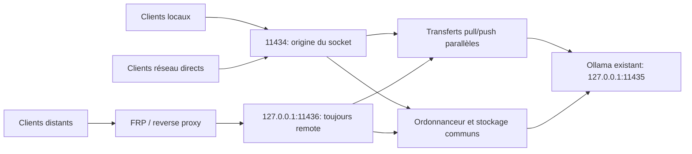

[English](../README.md) | [简体中文](README.zh-CN.md) | [繁體中文](README.zh-TW.md) | [日本語](README.ja.md) | [한국어](README.ko.md) | [Deutsch](README.de.md) | [Français](README.fr.md) | [Español](README.es.md)

<!-- readme:b00 -->

# Ollama Status Service

<!-- readme:b01 -->

**Sachez quand votre machine Ollama peut accepter du travail et donnez aux utilisateurs locaux le prochain créneau.**

<!-- readme:b02 -->

Une passerelle Windows, des services en arrière-plan et une application de zone de notification pour une installation Ollama existante. Elle suit l’exécution des requêtes, expose un état et une aide lisibles par les machines, et organise le travail local et distant dans une file commune.

<!-- readme:b03 -->

**Version actuelle : 1.6.1 · Windows x64 · Installation hors ligne**

<!-- readme:b04 -->

La version 1.6.1 corrige les mélanges de langues dans les résumés de version, l’historique des mises à jour et les messages de fin d’installation. Elle comprend huit langues d’interface avec sélection automatique et choix mémorisé, la détection automatique des proxys et un relais local de téléchargement intégré pour les réseaux TUN/Fake-IP. Les propositions de mise à jour Ollama périmées et les fenêtres de console fugitives lors des actions de notification sont corrigées. Voir [le réseau de téléchargement][link1]. La zone de notification permet aussi de vérifier et d’installer les mises à jour officielles d’Ollama : recherche des versions stables toutes les six heures, vérification du hachage et de la signature de l’éditeur, refus d’interrompre les tâches actives ou incertaines, puis reprise de la gestion par OSS après vérification des modèles et de la configuration d’origine. Voir [les mises à jour d’Ollama][link2]. Le paquet Windows est proposé ci-dessous.

<!-- readme:b05 -->

Depuis la version 1.4.0, `/manage` intègre une interface Web multiserveur : ajout/importation de nœuds, téléchargement/suppression de modèles et suspension/reprise de téléchargements persistants gérés par le serveur. Elle réutilise l’authentification du reverse proxy existant, sans compte, port ni processus de gestion supplémentaire. Voir [le guide de gestion][link3].

<!-- readme:b06 -->

La version 1.2.5 corrige les listes de modèles vides dues à des droits LocalService insuffisants. L’installation et la mise à niveau réparent les droits de l’arborescence des modèles, vérifient l’accès avec le véritable compte de service et comparent les inventaires du backend et de la passerelle avant d’annoncer la réussite. Le dossier de modèles par défaut du profil utilisateur sur C: est pris en charge. La correction des transferts `pull`/`push` simultanés de la version 1.2.4 est conservée.

<!-- readme:b07 -->

[Version 1.6.1][link4] · [ZIP Windows][link5] · [SHA256][link6] · [Historique][link7] · [Compiler les sources][link8]

<!-- readme:b08 -->

> Téléchargez `OllamaStatusService-Windows-x64-v1.6.1.zip` et sa somme de contrôle depuis la version ci-dessus, ou compilez les sources. Les archives « Source code » automatiques de GitHub ne sont pas des paquets installables. L’installateur, la zone de notification, /manage et /dashboard prennent en charge le chinois simplifié et traditionnel, l’anglais, le japonais, le coréen, l’allemand, le français et l’espagnol. La langue est détectée automatiquement ou choisie et mémorisée ; /status et /help traduisent les textes d’affichage tout en préservant les clés du protocole. Voir [les langues][link9].

<!-- readme:b09 -->

Les transferts de modèles `pull`/`push` contournent la file d’inférence et ses délais ; ils peuvent fonctionner simultanément et continuer à diffuser leur progression. `/status` les compte séparément : ils placent l’état de maintenance sur `busy` sans occuper de créneau d’inférence. Utilisez `can_start_now` pour connaître la disponibilité pour l’inférence.

<!-- readme:b10 -->

## Pourquoi une passerelle ?

<!-- readme:b11 -->

Un modèle installé ou chargé n’est pas nécessairement occupé. `/api/tags` énumère les modèles et `/api/ps` les modèles chargés ; aucun de ces points d’accès n’ordonnance les requêtes. Ce service observe les requêtes qu’il transmet, y compris les réponses en flux, les déconnexions et les fins d’exécution incertaines.

<!-- readme:b12 -->

Toutes les requêtes gérées doivent passer par la passerelle. Les accès directs au port Ollama sous-jacent échappent à son suivi. Ce projet est indépendant d’Ollama et ne fournit ni Ollama, ni modèles, ni bibliothèques GPU, ni pilotes.

<!-- readme:b13 -->

## Fonctionnalités

<!-- readme:b14 -->

- **État fiable :** `idle`, `busy`, `offline`, `unknown` et `stopping`, avec nombre, origine et identifiants des requêtes actives et en attente.
- **Priorité locale sans préemption :** la requête active se termine d’abord ; les requêtes locales en attente précèdent les distantes, avec FIFO dans chaque catégorie. Aucun créneau n’est réservé aux lots futurs.
- **Entrée dédiée aux proxys :** FRP, tunnels SSH et reverse proxys utilisent `11436` et sont toujours classés `remote`. Les en-têtes clients ne peuvent pas promouvoir une requête en `local`.
- **API descriptive :** `/help`, `/.well-known/ollama-status-service` et `/openapi.json` décrivent les capacités, limites de file et règles de nouvelle tentative.
- **Notification utile :** symboles colorés, compteurs de file, tableau de bord, journaux et commandes des services. Fermer l’application de notification n’arrête pas les services en arrière-plan.
- **Installation pratique :** détection du chemin des modèles avec sa provenance, contrôle d’intégrité, vérification avant mise à niveau et fenêtre unique de progression.
- **Récupération prudente :** les exécutions incertaines sont enregistrées dans SQLite et bloquent les nouvelles tâches jusqu’à récupération. La base des requêtes ne conserve ni prompts complets ni réponses générées.

<!-- readme:b15 -->

| Icône | Signification |
| --- | --- |
| ![Libre][link10] | Libre |
| ![Occupé][link11] | Occupé / requêtes en attente |
| ![Hors ligne][link12] | Backend indisponible |
| ![Inconnu][link13] | Fin incertaine ; récupération nécessaire |

<!-- readme:b16 -->

## Architecture

<!-- readme:b17 -->



<!-- readme:b18 -->

| Port | Rôle par défaut | Origine |
| --- | --- | --- |
| `11434` | Passerelle directe IPv4/IPv6 | Pair réel du socket ; utiliser le bouclage pour les clients locaux |
| `11436` | Entrée proxy sur bouclage IPv4 | Toujours `remote` |
| `11435` | Backend Ollama sur bouclage IPv4 | Usage interne uniquement ; ne pas contourner la passerelle |

<!-- readme:b19 -->

Les deux écouteurs partagent le même processus, cycle de vie, plafond d’exécution et file. Il s’agit d’ordonnancement de requêtes, pas de mémoire GPU distribuée. Le choix entre plusieurs machines reste à la charge du client ; un exemple utilisant uniquement la bibliothèque standard figure dans [`examples/route_request.py`][link14].

<!-- readme:b20 -->

## Installer ou mettre à niveau

<!-- readme:b21 -->

Prérequis : Windows 10/11 x64 ou Windows Server avec bureau, Ollama déjà installé et modèles locaux, Windows PowerShell 5.1, .NET Framework 4.8 et droits administrateur pour l’installation. Le Planificateur de tâches et la gestion du pare-feu Windows doivent être disponibles.

<!-- readme:b22 -->

1. Télécharger le ZIP de la version et son fichier `.sha256.txt`. Calculer le hachage du ZIP avec `Get-FileHash -Algorithm SHA256` et le comparer à la somme fournie.
2. Suspendre les nouveaux envois et laisser finir les tâches actives et en attente. Extraire **toute** l’archive dans un nouveau dossier, en dehors du répertoire du programme installé.
3. Exécuter **`Install.exe`**, vérifier l’exécutable Ollama et le dossier de modèles détectés, puis accepter l’invite UAC de Windows. Le même exécutable propose la mise à niveau d’une installation existante.
4. Ouvrir l’icône de notification ou `http://127.0.0.1:11434/dashboard`. L’environnement d’exécution, les dépendances et le wrapper de service sont inclus ; l’installation ne les télécharge pas.
5. Pour FRP ou un autre proxy sur la même machine, changer la destination locale en `127.0.0.1:11436`, puis vérifier l’origine avant de réactiver les clients.

<!-- readme:b23 -->

L’installateur réutilise Ollama et les modèles existants, déplace le backend vers `11435` et installe les services de passerelle et de backend. Installation, mise à niveau, récupération et arrêt des services peuvent interrompre le travail : **l’absence de préemption concerne l’ordonnancement normal, pas la maintenance**. Les contrôles de mise à niveau refusent les états occupés, en attente ou inconnus et les conflits du port proxy avant toute désinstallation. Si l’installation échoue après suppression de l’ancienne version, l’erreur est signalée et les sauvegardes sont conservées ; aucun retour arrière automatique n’est garanti.

<!-- readme:b24 -->

Exécuter **`Uninstall.exe`** pour retirer ce service et restaurer les paramètres d’intégration sauvegardés. L’installation Ollama et les modèles d’origine sont conservés. Instructions détaillées en chinois : [déploiement][link15] et [intégration IA][link16].

<!-- readme:b25 -->

Les droits sur les modèles sont accordés uniquement à **LocalService (`S-1-5-19`)** avec **Modification (Modify)**, y compris les sous-dossiers et fichiers protégés. Les règles d’origine sont enregistrées avant modification et restaurées à la désinstallation ou en cas d’échec ; les autres comptes, propriétaires et protections d’héritage sont préservés. Une tâche temporaire vérifie l’accès réel du compte de service puis est supprimée. Un refus explicite ou le chiffrement peut encore bloquer l’accès, avec une erreur indiquant le chemin. Les jonctions et points d’analyse dans l’arborescence des modèles sont refusés ; sélectionner le dossier réel.

<!-- readme:b26 -->

## Configuration de FRP et des reverse proxys

<!-- readme:b27 -->

Dans l’entrée proxy Ollama existante de **chaque serveur**, changer uniquement la destination locale :

<!-- readme:b28 -->

```toml
localIP = "127.0.0.1"
localPort = 11436
```

<!-- readme:b29 -->

En configuration INI, utiliser `local_ip` et `local_port`. Conserver le nom, le type, le port public/domaine, l’authentification et les paramètres TLS. Les URL des clients externes restent généralement identiques. Les exemples sont des fragments, pas des fichiers de remplacement : [`frpc-ollama.toml`][link17], [`frpc-ollama.ini`][link18].

<!-- readme:b30 -->

Nginx, Caddy et les tunnels SSH de la même machine doivent également viser `11436`. Un proxy situé sur une autre machine nécessite une adresse d’écoute explicitement accessible et des accès pare-feu convenablement limités. L’entrée accepte le HTTP ordinaire, **pas PROXY protocol**.

<!-- readme:b31 -->

```powershell
curl.exe --noproxy "*" http://127.0.0.1:11434/help
curl.exe --noproxy "*" http://127.0.0.1:11436/help
```

<!-- readme:b32 -->

Vérifier `version=1.6.1` et respectivement `request_origin=local` / `remote`, puis consulter `/help` via l’URL publique du proxy existant. Pendant l’inférence, examiner `/status.active_origin` et `requests[].origin`. Si le proxy vise toujours `11434`, la transmission par bouclage peut encore être prise à tort pour une requête locale.

<!-- readme:b33 -->

Séquence de validation : exécuter la requête distante A, mettre la distante B en file, puis la locale C avec un délai d’attente positif. A doit finir sans interruption ; C s’exécute avant B. Les deux requêtes en attente doivent respecter leur délai et la capacité de la file.

<!-- readme:b34 -->

## API et politique de file

<!-- readme:b35 -->

| Point d’accès | Fonction |
| --- | --- |
| `GET /status` | État, disponibilité, compteurs actifs/en attente et métadonnées des requêtes |
| `GET /help` | Limites effectives, capacités, origine et conseils au client |
| `GET /healthz` | Disponibilité de la passerelle et origine de cette sonde ; ne prouve pas que le backend est prêt |
| `GET /dashboard` | Tableau d’état dans le navigateur |
| `GET /manage` | Gestion intégrée des serveurs et modèles, avec authentification du reverse proxy existant |
| `GET /api/tags`, `GET /api/ps` | Inventaire Ollama transmis / modèles chargés |

<!-- readme:b36 -->

Définir `X-Ollama-Queue-Timeout` pour chaque requête d’inférence : `0` refuse immédiatement si le serveur est occupé ; une valeur positive attend au plus ce nombre de secondes ; l’absence d’en-tête utilise la valeur serveur par défaut (15 secondes). Le maximum par défaut est 3600 secondes ; consulter `/help` pour les limites de l’instance. Le délai d’attente n’interrompt pas une inférence déjà commencée. La concurrence d’exécution planifiée est de 1 (hors pull/push), avec au plus 64 requêtes en file et 64 MiB de données JSON en attente.

<!-- readme:b37 -->

```powershell
$body = @{ model='qwen3:8b'; prompt='Hello'; stream=$false } | ConvertTo-Json
Invoke-RestMethod -Uri 'http://127.0.0.1:11434/api/generate' `
  -Method Post -ContentType 'application/json; charset=utf-8' `
  -Headers @{'X-Ollama-Queue-Timeout'='30'} `
  -Body ([Text.Encoding]::UTF8.GetBytes($body)) -TimeoutSec 3700
```

<!-- readme:b38 -->

Remplacer le modèle d’exemple par un modèle installé localement. Une requête locale devient prioritaire **après son entrée effective dans la file**. Les requêtes sans attente peuvent être refusées si le serveur est occupé ; une charge locale continue peut retarder le travail distant jusqu’à expiration de son délai.

<!-- readme:b39 -->

`can_start_now` est un instantané, pas une réservation. Un basculement automatique sûr exige simultanément **HTTP 429/503 + `X-Ollama-Forwarded: false` + JSON `forwarded: false`**. Un délai dépassé, une déconnexion ou une sortie partielle ne prouve pas l’absence d’exécution ; ne pas rejouer silencieusement une requête incertaine sur une autre machine. Le service ne garantit pas une exécution exactement une fois entre serveurs.

<!-- readme:b40 -->

## Limites réseau et récupération

<!-- readme:b41 -->

**La passerelle n’ajoute aucune authentification.** Depuis 1.2.2, l’installation/mise à niveau règle l’autorisation TCP `11434` du produit pour toutes les sources, adresses locales et catégories de réseau, en la limitant au programme Python fourni. Les anciennes restrictions de source sont sauvegardées mais pas automatiquement conservées. Vérifier la règle après mise à niveau et appliquer l’authentification, HTTPS et les contrôles réseau appropriés. `11435` et `11436` restent par défaut sur le bouclage et ne sont pas automatiquement ouverts vers l’extérieur.

<!-- readme:b42 -->

La configuration persistante et l’historique sont dans `%ProgramData%\OllamaStatusService`, les fichiers du programme dans `%ProgramFiles%\OllamaStatusService`. Voir [`config.example.json`][link19]. Aucune API d’écriture distante de la configuration n’est fournie.

<!-- readme:b43 -->

Si la fin d’une requête ne peut être vérifiée, `unknown` bloque les nouvelles admissions. Utiliser la récupération depuis la notification uniquement lorsque l’arrêt des tâches inachevées est acceptable. Elle arrête et vérifie le backend avant d’effacer les enregistrements incertains. Ne pas supprimer la base alors qu’Ollama peut encore fonctionner. Les charges utiles en attente restent en mémoire et ne sont pas rejouées après redémarrage.

<!-- readme:b44 -->

## Développement et validation

<!-- readme:b45 -->

Les commandes de test figurent dans [les instructions de compilation][link8]. La version 1.6.1 a réussi 18 contrôles de localisation native, 11 contrôles Web, 18 scénarios isolés de mise à niveau OSS, 21 contrôles de notification/version, 12 scénarios du coordinateur de mise à jour Ollama avec contrôles de récupération supplémentaires, quatre contrôles de l’interface réelle de l’installateur et cinq contrôles de processus compilés sans console. La précédente intégration 1.6.0 a réussi 118 tests Python, dont 15 tests réseau de téléchargement et sept contrôles d’admission pendant une mise à niveau. Hachages, intégrité de l’archive, noms ASCII et concordance sources/paquet sont vérifiés avant publication. La version 1.2.5 a également testé la réparation réelle des ACL NTFS et l’accès LocalService dans un profil utilisateur de test sur C:. Les anciens rapports conservent les deux contrôles Ollama CLI concurrents de 1.2.4 et les contrôles d’interface de 1.2.3. Ces tests ne prouvent pas le bon déploiement ou le comportement GPU/FRP de chaque serveur de production. Voir [le rapport de validation][link20].

<!-- readme:b46 -->

Les huit éditions du README contiennent les mêmes sections, tableaux, exemples et limites d’exploitation. Elles sont générées à partir de blocs de traduction communs ; la création du paquet refuse toute édition absente ou périmée. Voir [la maintenance des traductions README][link21].

<!-- readme:b47 -->

Les exemples publics utilisent des valeurs fictives. Configurations de production, journaux et documents Word/Markdown originaux de développement ou du client sont volontairement exclus.

<!-- readme:b48 -->

## Licence

<!-- readme:b49 -->

Aucune licence n’a encore été choisie pour le code source du projet. Sa publication n’accorde pas une autorisation générale de l’utiliser, le modifier ou le redistribuer. Les mentions de licences tierces ne couvrent pas le code propre à ce projet.

<!-- readme:b50 -->

Les composants tiers conservent leurs licences respectives ; voir [`licenses/THIRD-PARTY-NOTICES.txt`][link22]. Le paquet publié inclut les licences de Python et des dépendances fournies.

[link1]: ../docs/DOWNLOAD-NETWORK.md
[link2]: ../docs/OLLAMA-UPDATES.md
[link3]: ../docs/MANAGE.md
[link4]: https://github.com/ozil56/OllamaStatusService/releases/tag/v1.6.1
[link5]: https://github.com/ozil56/OllamaStatusService/releases/download/v1.6.1/OllamaStatusService-Windows-x64-v1.6.1.zip
[link6]: https://github.com/ozil56/OllamaStatusService/releases/download/v1.6.1/OllamaStatusService-Windows-x64-v1.6.1.zip.sha256.txt
[link7]: ../CHANGELOG.md
[link8]: ../docs/BUILD.md
[link9]: ../docs/LANGUAGES.md
[link10]: ../docs/images/idle.png
[link11]: ../docs/images/busy.png
[link12]: ../docs/images/offline.png
[link13]: ../docs/images/unknown.png
[link14]: ../examples/route_request.py
[link15]: ../Deployment-Guide.txt
[link16]: ../Integration-Guide.txt
[link17]: ../examples/frpc-ollama.toml
[link18]: ../examples/frpc-ollama.ini
[link19]: ../config.example.json
[link20]: ../Verification-Report.txt
[link21]: ../docs/README-TRANSLATIONS.md
[link22]: ../licenses/THIRD-PARTY-NOTICES.txt
