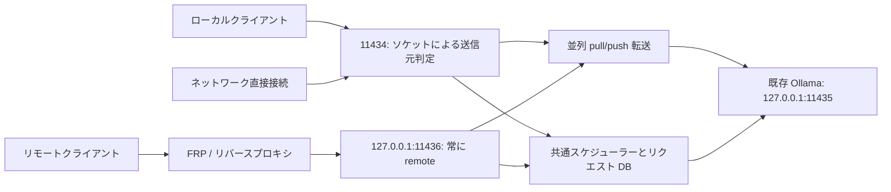

[English](../README.md) | [简体中文](README.zh-CN.md) | [繁體中文](README.zh-TW.md) | [日本語](README.ja.md) | [한국어](README.ko.md) | [Deutsch](README.de.md) | [Français](README.fr.md) | [Español](README.es.md)

<!-- readme:b00 -->

# Ollama Status Service

<!-- readme:b01 -->

**Ollama マシンが処理を受け付けられる状態かを把握し、次の実行枠をローカルユーザーに優先します。**

<!-- readme:b02 -->

既存の Ollama 環境向けの Windows ゲートウェイ、バックグラウンドサービス、システムトレイアプリです。リクエストの実行を追跡し、機械可読の状態とヘルプを提供して、ローカルとリモートの処理を共通キューでスケジュールします。

<!-- readme:b03 -->

**現在のバージョン：1.6.1 · Windows x64 · オフラインインストーラー**

<!-- readme:b04 -->

1.6.1 では、バージョン表示、保存済み更新履歴、インストール完了メッセージで言語が混在する問題を修正しました。8 言語の自動選択と手動設定の保存、プロキシの自動検出、TUN/Fake-IP ネットワーク向けのローカルダウンロード中継を備えています。更新済み Ollama に古い更新案内が残る問題と、トレイ操作時にコンソールが一瞬表示される問題も修正しました。[ダウンロードネットワーク][link1]を参照してください。トレイから公式 Ollama の更新確認とアップグレードも行えます。6 時間ごとに安定版を確認し、インストーラーのハッシュと発行元署名を検証します。実行中または完了不明の処理は中断せず、既存モデルと設定を検証してから OSS の管理を復元します。[Ollama の更新][link2]を参照してください。Windows パッケージは以下から取得できます。

<!-- readme:b05 -->

1.4.0 から `/manage` に複数サーバーの Web 管理画面を内蔵しています。ノードの追加・インポート、モデルのダウンロード・削除、サーバーが永続的に管理するダウンロードの一時停止・再開が可能です。既存のリバースプロキシ認証を利用し、別アカウント、ポート、管理プロセスは追加しません。[管理ガイド][link3]を参照してください。

<!-- readme:b06 -->

1.2.5 では LocalService の権限不足によってモデル一覧が空になる問題を修正しました。インストールとアップグレード時にモデルツリーの権限を修復し、実際のサービスアカウントでアクセスを検証して、バックエンドとゲートウェイのモデル一覧を照合した後に成功を報告します。C ドライブのユーザープロファイルにある標準モデルディレクトリにも対応しています。1.2.4 の同時 `pull`/`push` に関する修正も維持しています。

<!-- readme:b07 -->

[1.6.1 リリース][link4] · [Windows ZIP][link5] · [SHA256][link6] · [変更履歴][link7] · [ソースからビルド][link8]

<!-- readme:b08 -->

> 上のリリースから `OllamaStatusService-Windows-x64-v1.6.1.zip` とチェックサムを取得するか、ソースからビルドしてください。GitHub が自動生成する「Source code」アーカイブはインストール用パッケージではありません。インストーラー、トレイ、/manage、/dashboard は簡体字中国語、繁体字中国語、英語、日本語、韓国語、ドイツ語、フランス語、スペイン語に対応します。言語の自動選択と手動選択の保存が可能です。/status と /help はプロトコルのキーを保持し、表示テキストを翻訳します。[言語設定][link9]を参照してください。

<!-- readme:b09 -->

モデルの `pull`/`push` 転送は推論キューとそのタイムアウトを経由せず、同時実行と進捗のストリーミングを継続できます。`/status` では別に集計し、メンテナンス上の状態は `busy` にしますが、推論の実行枠は消費しません。推論を開始できるかは `can_start_now` で確認してください。

<!-- readme:b10 -->

## ゲートウェイが必要な理由

<!-- readme:b11 -->

モデルがインストール済み、またはロード済みでも、処理中とは限りません。`/api/tags` はモデル一覧、`/api/ps` はロード済みモデルを返し、どちらもリクエストスケジューラーではありません。本サービスは転送するリクエストを観察し、ストリーミング応答、切断、完了を確認できない状態も扱います。

<!-- readme:b12 -->

管理対象のリクエストはすべてゲートウェイを通す必要があります。内部の Ollama ポートへの直接アクセスは集計対象外です。本プロジェクトは Ollama とは独立しており、Ollama 本体、モデル、GPU ライブラリ、ドライバーは同梱しません。

<!-- readme:b13 -->

## 主な機能

<!-- readme:b14 -->

- **明確な状態：** `idle`、`busy`、`offline`、`unknown`、`stopping` と、実行中・待機中のリクエスト数、送信元、ID を表示します。
- **実行中の処理を奪わないローカル優先：** 現在のリクエストを完了させてから、待機中のローカルをリモートより先に実行します。同じ区分では FIFO です。将来のバッチ用に枠を予約しません。
- **プロキシ専用入口：** FRP、SSH トンネル、リバースプロキシは `11436` を使い、常に `remote` と判定します。クライアントのヘッダーで `local` に昇格させることはできません。
- **自己記述型 API：** `/help`、`/.well-known/ollama-status-service`、`/openapi.json` が機能、キュー上限、再試行ルールを説明します。
- **便利なトレイ表示：** 色付き記号、キュー数、ダッシュボード、ログ、サービス操作を提供します。トレイを終了してもバックグラウンドサービスは停止しません。
- **実用的なインストーラー：** モデルパスと検出元の表示、パッケージの整合性検証、アップグレード前チェック、単一ウィンドウでの進捗表示を備えます。
- **慎重な復旧：** 実行状態が不明な場合は SQLite に永続化し、復旧まで新しい処理を止めます。リクエスト DB にプロンプト全文や生成結果は保存しません。

<!-- readme:b15 -->

| トレイ | 意味 |
| --- | --- |
| ![待機][link10] | アイドル |
| ![処理中][link11] | 処理中／リクエスト待機あり |
| ![オフライン][link12] | バックエンド利用不可 |
| ![不明][link13] | 完了不明、復旧が必要 |

<!-- readme:b16 -->

## 構成

<!-- readme:b17 -->



<!-- readme:b18 -->

| ポート | 標準の役割 | 送信元判定 |
| --- | --- | --- |
| `11434` | IPv4/IPv6 直接接続ゲートウェイ | 実際のソケット相手を使用。ローカルクライアントはループバックを使用 |
| `11436` | IPv4 ループバックのプロキシ入口 | 常に `remote` |
| `11435` | IPv4 ループバックの Ollama バックエンド | 内部専用。ゲートウェイを迂回しないこと |

<!-- readme:b19 -->

2 つのゲートウェイリスナーは、プロセス、ライフサイクル、実行上限、キューを共有します。これはリクエスト単位のスケジュールであり、GPU メモリの分散共有ではありません。複数マシンの選択はクライアントの責任です。標準ライブラリのみを使う例は [`examples/route_request.py`][link14] にあります。

<!-- readme:b20 -->

## インストール／アップグレード

<!-- readme:b21 -->

必要環境：Windows 10/11 x64 またはデスクトップ付き Windows Server、既存の Ollama とローカルモデル、Windows PowerShell 5.1、.NET Framework 4.8、インストール時の管理者権限。タスクスケジューラと Windows ファイアウォールの管理機能も必要です。

<!-- readme:b22 -->

1. リリース ZIP と `.sha256.txt` をダウンロードし、`Get-FileHash -Algorithm SHA256` で計算した ZIP のハッシュを付属の値と照合します。
2. 新規リクエストの送信を止め、実行中と待機中の処理が終わるまで待ちます。インストール先とは別の新規フォルダーにアーカイブ**全体**を展開します。
3. **`Install.exe`** を起動し、検出された Ollama 実行ファイルとモデルディレクトリを確認して Windows UAC を承認します。既存環境のアップグレードにも同じプログラムを使います。
4. トレイアイコン、または `http://127.0.0.1:11434/dashboard` を開きます。ランタイム、依存関係、サービスラッパーは同梱済みで、インストール時にはダウンロードしません。
5. FRP など同一マシンのプロキシはローカル転送先を `127.0.0.1:11436` に変更し、送信元判定を確認してからクライアントを再開します。

<!-- readme:b23 -->

インストーラーは既存の Ollama とモデルを再利用し、バックエンドを `11435` に変更して、ゲートウェイとバックエンドのサービスを登録します。インストール、アップグレード、復旧、サービス停止は処理を中断する場合があります。**実行中の処理を奪わない保証は通常のスケジュールに適用され、保守作業には適用されません**。アップグレードは旧版を削除する前に、処理中・待機中・状態不明やプロキシポートの競合を検出して拒否します。旧版削除後にインストールが失敗した場合はエラーを報告しバックアップを保持しますが、自動ロールバックは保証しません。

<!-- readme:b24 -->

**`Uninstall.exe`** で本サービスを削除し、バックアップした連携設定を復元します。元の Ollama とモデルは保持します。中国語の詳細説明は[導入ガイド][link15]と [AI 連携ガイド][link16]を参照してください。

<!-- readme:b25 -->

モデルへの権限は **LocalService（`S-1-5-19`）** にのみ**変更（Modify）**として付与し、保護された子ディレクトリやファイルも対象にします。変更前に元の規則を記録し、アンインストール時やインストール失敗時に復元します。他のアカウント、所有者、継承の保護は維持します。一時タスクで実際のサービスアカウントからアクセスを確認し、終了後に削除します。明示的な拒否や暗号化によってアクセスできない場合は対象パスのエラーを報告します。モデルツリー内のジャンクションや再解析ポイントは拒否するため、実体のディレクトリを指定してください。

<!-- readme:b26 -->

## FRP とリバースプロキシの設定

<!-- readme:b27 -->

**各サーバー**の既存 Ollama プロキシ設定で、ローカル転送先だけを変更します：

<!-- readme:b28 -->

```toml
localIP = "127.0.0.1"
localPort = 11436
```

<!-- readme:b29 -->

INI では `local_ip` と `local_port` を使います。既存のプロキシ名、種類、公開ポート／ドメイン、認証、TLS 設定を維持してください。外部クライアントの URL は通常そのままです。例は設定断片であり、ファイル全体の置き換え用ではありません：[`frpc-ollama.toml`][link17]、[`frpc-ollama.ini`][link18]。

<!-- readme:b30 -->

同一マシンの Nginx、Caddy、SSH トンネルも `11436` を転送先にします。別マシンのプロキシには、到達可能なバインドアドレスの明示的な設定と、適切に制限したファイアウォール許可が必要です。この入口は通常の HTTP を受け付け、**PROXY protocol には対応しません**。

<!-- readme:b31 -->

```powershell
curl.exe --noproxy "*" http://127.0.0.1:11434/help
curl.exe --noproxy "*" http://127.0.0.1:11436/help
```

<!-- readme:b32 -->

`version=1.6.1` と、各入口でそれぞれ `request_origin=local` / `remote` になることを確認し、既存の公開プロキシ URL 経由でも `/help` を確認します。推論中は `/status.active_origin` と `requests[].origin` を確認してください。プロキシが依然として `11434` を向いていると、ループバック転送をローカル処理と誤判定する場合があります。

<!-- readme:b33 -->

受け入れ確認：リモート A を実行し、リモート B をキューに入れ、その後ローカル C を正の待機タイムアウトで入れます。A は中断せずに完了し、その後 C が B より先に実行される必要があります。待機中の両リクエストは待機期限とキュー容量の範囲内に収めてください。

<!-- readme:b34 -->

## API とキューポリシー

<!-- readme:b35 -->

| エンドポイント | 用途 |
| --- | --- |
| `GET /status` | 現在の状態、準備状況、実行中／待機中の数、リクエスト情報 |
| `GET /help` | 実際の上限、機能、送信元、クライアント向け説明 |
| `GET /healthz` | ゲートウェイの生存と今回のプローブの送信元。バックエンド準備完了の証明ではない |
| `GET /dashboard` | ブラウザーの状態パネル |
| `GET /manage` | 複数サーバーとモデルの内蔵管理。既存リバースプロキシ認証を利用 |
| `GET /api/tags`, `GET /api/ps` | Ollama のモデル一覧／ロード済みモデルを転送 |

<!-- readme:b36 -->

推論リクエストごとに `X-Ollama-Queue-Timeout` を指定できます。`0` は処理中なら即時拒否、正数はその秒数まで待機、省略時はサーバーの既定値（15 秒）です。既定の最大値は 3600 秒で、実際のインスタンスの上限は `/help` を確認してください。待機期限は開始済みの推論を中断しません。スケジュール対象の実行並列数は 1（pull/push を除く）、待機は最大 64 リクエスト、待機 JSON の合計は最大 64 MiB です。

<!-- readme:b37 -->

```powershell
$body = @{ model='qwen3:8b'; prompt='Hello'; stream=$false } | ConvertTo-Json
Invoke-RestMethod -Uri 'http://127.0.0.1:11434/api/generate' `
  -Method Post -ContentType 'application/json; charset=utf-8' `
  -Headers @{'X-Ollama-Queue-Timeout'='30'} `
  -Body ([Text.Encoding]::UTF8.GetBytes($body)) -TimeoutSec 3700
```

<!-- readme:b38 -->

例のモデルはローカルにインストール済みのものに置き換えてください。ローカルリクエストが優先されるのは**実際にキューに入った後**です。待機ゼロのリクエストは処理中なら拒否される場合があり、継続的なローカル処理によってリモートが期限まで待たされる場合もあります。

<!-- readme:b39 -->

`can_start_now` は状態のスナップショットであり予約ではありません。安全な自動切り替えには **HTTP 429/503 + `X-Ollama-Forwarded: false` + JSON `forwarded: false`** のすべてが必要です。タイムアウト、切断、部分出力だけでは実行が始まらなかった証明になりません。不確定なリクエストを別のマシンに黙って再送しないでください。サーバー間で厳密に一度だけ実行される保証はありません。

<!-- readme:b40 -->

## ネットワークと復旧の境界

<!-- readme:b41 -->

**ゲートウェイ自体は認証を追加しません。** 1.2.2 以降、インストール／アップグレードで本製品の TCP `11434` 許可規則を全送信元、全ローカルアドレス、全ネットワークプロファイルに設定し、同梱 Python プログラムに限定します。以前の送信元制限はバックアップしますが自動継承しません。アップグレード後に規則を確認し、適切な認証、HTTPS、ネットワーク制御を適用してください。`11435` と `11436` は既定でループバックのみで、外部には自動開放しません。

<!-- readme:b42 -->

永続設定と履歴は `%ProgramData%\OllamaStatusService`、プログラムファイルは `%ProgramFiles%\OllamaStatusService` に保存します。[`config.example.json`][link19] を参照してください。設定をリモートから書き換える API はありません。

<!-- readme:b43 -->

リクエストの完了を確認できない場合、`unknown` が新規受け付けを止めます。未完了処理を終了してよい場合にのみトレイの復旧を使ってください。復旧はバックエンドを停止・確認してから不確定な記録を消去します。Ollama が動作している可能性がある間は DB を削除しないでください。キューのペイロードはメモリに保持し、再起動後には再実行しません。

<!-- readme:b44 -->

## 開発と検証

<!-- readme:b45 -->

テストコマンドは[ビルド手順][link8]を参照してください。1.6.1 ではネイティブ国際化 18 件、Web 国際化 11 件、隔離 OSS アップグレード 18 シナリオ、トレイ／リリース 21 件、Ollama 更新コーディネーター 12 シナリオと追加復旧チェック、実際のインストーラー GUI 4 件、コンパイル済み非表示ワーカー 5 件に合格しました。先行する 1.6.0 の統合検証は Python 118 件に合格し、ダウンロードネットワーク 15 件とアップグレード受け付け保護 7 件を含みます。公開前にパッケージハッシュ、アーカイブ整合性、ASCII ファイル名、ソースとパッケージの一致を確認します。1.2.5 では C ドライブのユーザープロファイル試験環境で実際の NTFS ACL 修復と LocalService アクセスも検証しました。過去の報告には 1.2.4 の Ollama CLI 同時実行 2 件と 1.2.3 のインストーラー UI 確認も残しています。これらはすべての本番サーバーでの導入や GPU/FRP の動作を保証するものではありません。[検証報告][link20]を参照してください。

<!-- readme:b46 -->

8 言語の README は同じ章、表、例、運用上の境界を含みます。共通の翻訳ブロックから生成し、欠落や古い版があるとパッケージ作成を中止します。[README 翻訳の保守][link21]を参照してください。

<!-- readme:b47 -->

公開例ではプレースホルダーを使います。本番設定、ログ、元のクライアント／開発過程の Word・Markdown 文書は公開対象から除外しています。

<!-- readme:b48 -->

## ライセンス

<!-- readme:b49 -->

本プロジェクトのソースコードには、まだライセンスを選定していません。公開したことによって、ソースの利用、変更、再配布を一般的に許可するものではありません。第三者コンポーネントのライセンス表記は、本プロジェクト自身のコードには適用されません。

<!-- readme:b50 -->

第三者コンポーネントは各自のライセンスに従います。[`licenses/THIRD-PARTY-NOTICES.txt`][link22] を参照してください。リリースには Python と同梱依存関係のライセンスファイルを含みます。

[link1]: ../docs/DOWNLOAD-NETWORK.md
[link2]: ../docs/OLLAMA-UPDATES.md
[link3]: ../docs/MANAGE.md
[link4]: https://github.com/ozil56/OllamaStatusService/releases/tag/v1.6.1
[link5]: https://github.com/ozil56/OllamaStatusService/releases/download/v1.6.1/OllamaStatusService-Windows-x64-v1.6.1.zip
[link6]: https://github.com/ozil56/OllamaStatusService/releases/download/v1.6.1/OllamaStatusService-Windows-x64-v1.6.1.zip.sha256.txt
[link7]: ../CHANGELOG.md
[link8]: ../docs/BUILD.md
[link9]: ../docs/LANGUAGES.md
[link10]: ../docs/images/idle.png
[link11]: ../docs/images/busy.png
[link12]: ../docs/images/offline.png
[link13]: ../docs/images/unknown.png
[link14]: ../examples/route_request.py
[link15]: ../Deployment-Guide.txt
[link16]: ../Integration-Guide.txt
[link17]: ../examples/frpc-ollama.toml
[link18]: ../examples/frpc-ollama.ini
[link19]: ../config.example.json
[link20]: ../Verification-Report.txt
[link21]: ../docs/README-TRANSLATIONS.md
[link22]: ../licenses/THIRD-PARTY-NOTICES.txt
