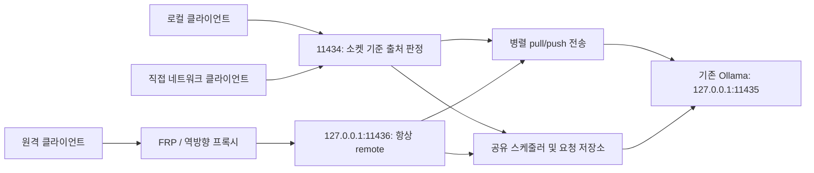

[English](../README.md) | [简体中文](README.zh-CN.md) | [繁體中文](README.zh-TW.md) | [日本語](README.ja.md) | [한국어](README.ko.md) | [Deutsch](README.de.md) | [Français](README.fr.md) | [Español](README.es.md)

<!-- readme:b00 -->

# Ollama Status Service

<!-- readme:b01 -->

**Ollama 컴퓨터가 작업을 받을 수 있는지 확인하고 로컬 사용자에게 다음 실행 순서를 우선 배정합니다.**

<!-- readme:b02 -->

기존 Ollama 설치를 위한 Windows 게이트웨이, 백그라운드 서비스, 시스템 트레이 앱입니다. 요청 실행을 추적하고 기계가 읽을 수 있는 상태와 도움말을 제공하며, 로컬 및 원격 작업을 하나의 공유 큐로 관리합니다.

<!-- readme:b03 -->

**현재 버전: 1.6.1 · Windows x64 · 오프라인 설치 프로그램**

<!-- readme:b04 -->

1.6.1은 버전 요약, 저장된 업데이트 기록, 설치 완료 메시지에서 언어가 섞이는 문제를 수정합니다. 자동 언어 선택과 수동 선택 저장을 지원하는 8개 UI 언어, 자동 프록시 검색, TUN/Fake-IP 네트워크용 내장 로컬 다운로드 중계 기능을 포함합니다. 이미 업데이트한 Ollama에 오래된 업그레이드 안내가 남는 문제와 트레이 작업 중 콘솔 창이 잠깐 나타나는 문제도 수정했습니다. [다운로드 네트워크][link1]를 참조하세요. 트레이에서 공식 Ollama 업데이트 확인과 업그레이드도 제공합니다. 6시간마다 안정 버전을 확인하고 설치 파일의 해시와 게시자 서명을 검증합니다. 실행 중이거나 완료 여부가 불확실한 작업은 중단하지 않으며, 기존 모델과 설정을 확인한 뒤 OSS 관리를 복원합니다. [Ollama 업데이트][link2]를 참조하세요. Windows 패키지는 아래 링크에서 받을 수 있습니다.

<!-- readme:b05 -->

1.4.0부터 `/manage`에 여러 서버를 관리하는 웹 화면이 내장되어 있습니다. 노드 추가/가져오기, 모델 다운로드/삭제, 서버가 영구적으로 관리하는 다운로드 일시 중지/재개를 지원합니다. 기존 역방향 프록시 인증을 사용하며 별도 계정, 포트, 관리 프로세스를 추가하지 않습니다. [관리 가이드][link3]를 참조하세요.

<!-- readme:b06 -->

1.2.5는 LocalService 권한 부족으로 모델 목록이 비는 문제를 수정합니다. 설치 및 업그레이드 시 모델 디렉터리 트리 권한을 복구하고 실제 서비스 계정으로 접근을 확인하며, 백엔드와 게이트웨이의 모델 목록을 비교한 뒤 성공을 보고합니다. C: 드라이브 사용자 프로필의 기본 모델 디렉터리를 지원합니다. 1.2.4의 동시 `pull`/`push` 수정도 유지합니다.

<!-- readme:b07 -->

[1.6.1 릴리스][link4] · [Windows ZIP][link5] · [SHA256][link6] · [변경 기록][link7] · [소스 빌드][link8]

<!-- readme:b08 -->

> 위 릴리스에서 `OllamaStatusService-Windows-x64-v1.6.1.zip`과 체크섬을 다운로드하거나 소스에서 빌드하세요. GitHub가 자동 생성하는 “Source code” 압축 파일은 설치 패키지가 아닙니다. 설치 프로그램, 트레이, /manage, /dashboard는 중국어 간체·번체, 영어, 일본어, 한국어, 독일어, 프랑스어, 스페인어를 지원합니다. 언어 자동 선택과 수동 선택 저장이 가능하며, /status와 /help는 프로토콜 키를 유지하면서 표시 문구를 번역합니다. [언어 설정][link9]을 참조하세요.

<!-- readme:b09 -->

모델 `pull`/`push` 전송은 추론 큐와 해당 시간 제한을 거치지 않으며, 동시에 실행되고 진행 상태를 계속 스트리밍할 수 있습니다. `/status`는 이를 별도로 집계합니다. 유지보수 상태는 `busy`가 되지만 추론 실행 자리를 차지하지는 않습니다. 추론을 시작할 수 있는지는 `can_start_now`로 판단하세요.

<!-- readme:b10 -->

## 게이트웨이가 필요한 이유

<!-- readme:b11 -->

설치되거나 메모리에 로드된 모델이 반드시 작업 중인 것은 아닙니다. `/api/tags`는 모델을, `/api/ps`는 로드된 모델을 나열하며 둘 다 요청 스케줄러가 아닙니다. 이 서비스는 전달하는 요청을 관찰하며 스트리밍 응답, 연결 끊김, 완료를 확인할 수 없는 상태도 추적합니다.

<!-- readme:b12 -->

관리할 요청은 모두 게이트웨이를 통과해야 합니다. 내부 Ollama 포트에 직접 접근하는 작업은 집계 범위 밖입니다. 이 프로젝트는 Ollama와 독립적이며 Ollama, 모델, GPU 라이브러리, 드라이버를 포함하지 않습니다.

<!-- readme:b13 -->

## 주요 기능

<!-- readme:b14 -->

- **명확한 상태:** `idle`, `busy`, `offline`, `unknown`, `stopping`과 실행 중/대기 중 요청 수, 출처 및 ID를 제공합니다.
- **실행 중 작업을 중단하지 않는 로컬 우선:** 현재 요청이 먼저 완료되며, 대기 중 로컬 요청이 원격 요청보다 먼저 실행됩니다. 같은 종류에서는 FIFO 순서입니다. 미래 배치를 위해 자리를 예약하지 않습니다.
- **프록시 전용 진입점:** FRP, SSH 터널, 역방향 프록시는 `11436`을 사용하며 항상 `remote`로 분류됩니다. 클라이언트 헤더로 요청을 `local`로 승격할 수 없습니다.
- **자체 설명 API:** `/help`, `/.well-known/ollama-status-service`, `/openapi.json`에서 기능, 큐 제한, 재시도 규칙을 안내합니다.
- **유용한 트레이 표시:** 색상 아이콘, 큐 수, 대시보드, 로그, 서비스 제어를 제공합니다. 트레이를 닫아도 백그라운드 서비스는 중지되지 않습니다.
- **실용적인 설치 프로그램:** 출처가 표시되는 모델 경로 검색, 패키지 무결성 확인, 업그레이드 사전 검사, 단일 창 진행 표시를 제공합니다.
- **신중한 복구:** 실행이 불확실하면 SQLite에 기록하고 복구할 때까지 새 작업을 차단합니다. 요청 데이터베이스에 전체 프롬프트나 생성 응답을 저장하지 않습니다.

<!-- readme:b15 -->

| 트레이 | 의미 |
| --- | --- |
| ![유휴][link10] | 유휴 |
| ![작업 중][link11] | 작업 중 / 대기 요청 있음 |
| ![오프라인][link12] | 백엔드 사용 불가 |
| ![알 수 없음][link13] | 완료 여부 불확실, 복구 필요 |

<!-- readme:b16 -->

## 구성

<!-- readme:b17 -->



<!-- readme:b18 -->

| 포트 | 기본 역할 | 출처 |
| --- | --- | --- |
| `11434` | IPv4/IPv6 직접 접속 게이트웨이 | 실제 소켓 상대 기준; 로컬 클라이언트는 루프백 사용 |
| `11436` | IPv4 루프백 프록시 진입점 | 항상 `remote` |
| `11435` | IPv4 루프백 Ollama 백엔드 | 내부 전용; 게이트웨이를 우회하지 않음 |

<!-- readme:b19 -->

두 게이트웨이 리스너는 프로세스, 수명 주기, 실행 제한, 큐를 공유합니다. 이는 요청 단위 스케줄링이며 분산 GPU 메모리가 아닙니다. 여러 컴퓨터 중 선택하는 책임은 클라이언트에 있습니다. 표준 라이브러리만 사용하는 예제는 [`examples/route_request.py`][link14]에 있습니다.

<!-- readme:b20 -->

## 설치 또는 업그레이드

<!-- readme:b21 -->

요구 사항: Windows 10/11 x64 또는 데스크톱이 있는 Windows Server, 기존 Ollama와 로컬 모델, Windows PowerShell 5.1, .NET Framework 4.8, 설치용 관리자 권한. 작업 스케줄러와 Windows 방화벽 관리 기능도 사용할 수 있어야 합니다.

<!-- readme:b22 -->

1. 릴리스 ZIP과 `.sha256.txt`를 다운로드합니다. `Get-FileHash -Algorithm SHA256`으로 ZIP 해시를 계산하여 제공된 체크섬과 비교합니다.
2. 새 요청 제출을 중지하고 실행 중 및 대기 중 작업이 끝날 때까지 기다립니다. 설치된 프로그램 디렉터리 밖의 새 폴더에 압축 파일 **전체**를 풉니다.
3. **`Install.exe`**를 실행하고 검색된 Ollama 실행 파일과 모델 디렉터리를 확인한 뒤 Windows UAC 요청을 승인합니다. 기존 설치도 같은 프로그램에서 업그레이드합니다.
4. 트레이 아이콘을 열거나 `http://127.0.0.1:11434/dashboard`에 접속합니다. 런타임, 의존성, 서비스 래퍼가 포함되어 있어 설치 중 다운로드하지 않습니다.
5. FRP 또는 같은 컴퓨터의 다른 프록시는 로컬 목적지를 `127.0.0.1:11436`으로 바꾸고, 출처를 확인한 뒤 클라이언트 요청을 재개합니다.

<!-- readme:b23 -->

설치 프로그램은 기존 Ollama와 모델을 재사용하고 백엔드를 `11435`로 변경하며 게이트웨이/백엔드 서비스를 설치합니다. 설치, 업그레이드, 복구, 서비스 중지는 작업을 중단할 수 있습니다. **비선점은 정상 스케줄링에 적용되며 유지보수에는 적용되지 않습니다.** 업그레이드는 기존 버전을 제거하기 전에 작업 중/대기 중/불확실 상태와 프록시 포트 충돌을 검사하여 거부합니다. 이전 버전 제거 후 설치가 실패하면 오류를 알리고 백업을 유지하지만 자동 롤백을 보장하지 않습니다.

<!-- readme:b24 -->

**`Uninstall.exe`**를 실행하면 이 서비스를 제거하고 백업한 통합 설정을 복원합니다. 원래 Ollama 설치와 모델은 유지됩니다. 중국어 상세 안내는 [배포 가이드][link15]와 [AI 연동 가이드][link16]를 참조하세요.

<!-- readme:b25 -->

모델 권한은 **LocalService (`S-1-5-19`)**에만 **수정(Modify)** 권한으로 부여하며 보호된 하위 폴더와 파일도 포함합니다. 변경 전에 원래 규칙을 기록하고 제거 또는 설치 실패 시 복원합니다. 다른 계정, 소유자, 상속 보호는 유지합니다. 임시 작업으로 실제 서비스 계정 접근을 검사하고 검사 후 제거합니다. 명시적 거부나 암호화는 여전히 접근을 막을 수 있으며 해당 경로를 포함한 오류가 표시됩니다. 모델 트리의 디렉터리 연결 및 재분석 지점은 허용하지 않으므로 실제 디렉터리를 선택하세요.

<!-- readme:b26 -->

## FRP 및 역방향 프록시 설정

<!-- readme:b27 -->

**각 서버**의 기존 Ollama 프록시 항목에서 로컬 목적지만 변경합니다.

<!-- readme:b28 -->

```toml
localIP = "127.0.0.1"
localPort = 11436
```

<!-- readme:b29 -->

INI 설정에서는 `local_ip`와 `local_port`를 사용합니다. 기존 프록시 이름, 종류, 공개 포트/도메인, 인증, TLS 설정은 유지합니다. 외부 클라이언트 URL은 보통 바뀌지 않습니다. 예제는 전체 교체용 파일이 아니라 설정 조각입니다: [`frpc-ollama.toml`][link17], [`frpc-ollama.ini`][link18].

<!-- readme:b30 -->

같은 컴퓨터의 Nginx, Caddy, SSH 터널도 `11436`을 가리켜야 합니다. 다른 컴퓨터의 프록시는 접근 가능한 바인드 주소를 명시적으로 설정하고 방화벽 접근을 적절히 제한해야 합니다. 이 진입점은 일반 HTTP를 받으며 **PROXY protocol은 지원하지 않습니다**.

<!-- readme:b31 -->

```powershell
curl.exe --noproxy "*" http://127.0.0.1:11434/help
curl.exe --noproxy "*" http://127.0.0.1:11436/help
```

<!-- readme:b32 -->

`version=1.6.1`과 각 진입점의 `request_origin=local` / `remote`를 확인한 뒤 기존 공개 프록시 URL로 `/help`를 확인합니다. 추론 중에는 `/status.active_origin`과 `requests[].origin`을 확인하세요. 프록시가 계속 `11434`를 가리키면 루프백 전달이 로컬 작업으로 오인될 수 있습니다.

<!-- readme:b33 -->

검증 순서: 원격 A를 실행하고, 원격 B를 대기열에 넣은 뒤, 양수 대기 시간으로 로컬 C를 넣습니다. A는 중단 없이 완료되어야 하며 다음에는 C가 B보다 먼저 실행되어야 합니다. 대기 중인 두 요청은 각각의 대기 기한과 큐 용량을 넘지 않아야 합니다.

<!-- readme:b34 -->

## API와 큐 정책

<!-- readme:b35 -->

| 엔드포인트 | 용도 |
| --- | --- |
| `GET /status` | 현재 상태, 준비 여부, 실행/대기 수 및 요청 메타데이터 |
| `GET /help` | 실제 제한, 기능, 출처 및 클라이언트 안내 |
| `GET /healthz` | 게이트웨이 생존 여부와 이번 검사 출처; 백엔드 준비 완료를 보증하지 않음 |
| `GET /dashboard` | 브라우저 상태 패널 |
| `GET /manage` | 내장 다중 서버/모델 관리, 기존 역방향 프록시 인증 사용 |
| `GET /api/tags`, `GET /api/ps` | 프록시로 전달한 Ollama 모델 목록 / 로드된 모델 |

<!-- readme:b36 -->

추론 요청마다 `X-Ollama-Queue-Timeout`을 사용할 수 있습니다. `0`은 사용 중이면 즉시 거부하고, 양수는 그 초 수까지 기다리며, 생략하면 서버 기본값(15초)을 사용합니다. 기본 최대값은 3600초이며 실행 중 인스턴스의 제한은 `/help`에서 확인합니다. 대기 기한은 이미 시작한 추론을 중단하지 않습니다. 스케줄된 실행 동시성은 1(pull/push 제외), 대기 요청은 최대 64개, 대기 JSON 데이터는 총 64 MiB입니다.

<!-- readme:b37 -->

```powershell
$body = @{ model='qwen3:8b'; prompt='Hello'; stream=$false } | ConvertTo-Json
Invoke-RestMethod -Uri 'http://127.0.0.1:11434/api/generate' `
  -Method Post -ContentType 'application/json; charset=utf-8' `
  -Headers @{'X-Ollama-Queue-Timeout'='30'} `
  -Body ([Text.Encoding]::UTF8.GetBytes($body)) -TimeoutSec 3700
```

<!-- readme:b38 -->

예제 모델을 로컬에 설치된 모델로 바꾸세요. 로컬 요청은 **실제로 큐에 들어간 뒤에만** 우선권을 얻습니다. 대기 시간이 0이면 사용 중일 때 거부될 수 있으며, 지속적인 로컬 작업 때문에 원격 요청이 기한까지 지연될 수 있습니다.

<!-- readme:b39 -->

`can_start_now`는 상태 스냅샷이며 예약이 아닙니다. 안전한 자동 서버 전환에는 **HTTP 429/503 + `X-Ollama-Forwarded: false` + JSON `forwarded: false`**가 모두 필요합니다. 시간 초과, 연결 끊김, 부분 출력은 실행이 시작되지 않았다는 증거가 아닙니다. 불확실한 요청을 다른 컴퓨터에서 사용자에게 알리지 않고 재실행하지 마세요. 서비스는 서버 간 정확히 한 번 실행을 보장하지 않습니다.

<!-- readme:b40 -->

## 네트워크와 복구 범위

<!-- readme:b41 -->

**게이트웨이는 인증을 추가하지 않습니다.** 1.2.2부터 설치/업그레이드는 이 제품의 TCP `11434` 허용 규칙을 모든 출처, 로컬 주소, 네트워크 프로필에 적용하고 번들 Python 프로그램으로 제한합니다. 이전 사용자 지정 출처 제한은 백업하지만 자동으로 유지하지 않습니다. 업그레이드 후 규칙을 확인하고 적절한 인증, HTTPS, 네트워크 접근 제어를 적용하세요. `11435`와 `11436`은 기본적으로 루프백만 사용하며 외부에 자동 개방되지 않습니다.

<!-- readme:b42 -->

영구 설정과 기록은 `%ProgramData%\OllamaStatusService`, 프로그램 파일은 `%ProgramFiles%\OllamaStatusService`에 있습니다. [`config.example.json`][link19]을 참조하세요. 원격으로 설정을 쓰는 API는 제공하지 않습니다.

<!-- readme:b43 -->

요청 완료를 확인할 수 없으면 `unknown`이 새 요청 수락을 막습니다. 미완료 작업을 종료해도 되는 경우에만 트레이 복구를 사용하세요. 복구는 백엔드를 중지하고 확인한 뒤 불확실한 기록을 지웁니다. Ollama가 여전히 실행 중일 수 있을 때는 데이터베이스를 삭제하지 마세요. 큐의 데이터는 메모리에 있으며 다시 시작한 후 재실행되지 않습니다.

<!-- readme:b44 -->

## 개발 및 검증

<!-- readme:b45 -->

테스트 명령은 [빌드 안내][link8]를 참조하세요. 1.6.1은 네이티브 현지화 18개, 웹 현지화 11개, 격리된 OSS 업그레이드 시나리오 18개, 트레이/릴리스 검사 21개, Ollama 업데이트 조정기 시나리오 12개와 추가 복구 검사, 실제 설치 프로그램 GUI 검사 4개, 컴파일된 숨김 작업 프로세스 검사 5개를 통과했습니다. 앞선 1.6.0 통합 검증은 Python 테스트 118개를 통과했으며 다운로드 네트워크 15개와 업그레이드 요청 수락 보호 7개를 포함합니다. 게시 전 패키지 해시, 압축 무결성, ASCII 파일명, 소스/패키지 일치를 확인합니다. 1.2.5는 C: 사용자 프로필 시험 환경에서 실제 NTFS ACL 복구와 LocalService 접근도 검증했습니다. 이전 보고서에는 1.2.4의 Ollama CLI 동시 실행 검사 2개와 1.2.3 설치 UI 검사도 남아 있습니다. 모든 운영 서버의 배포나 GPU/FRP 동작을 검증했다는 뜻은 아닙니다. [검증 보고서][link20]를 참조하세요.

<!-- readme:b46 -->

8개 언어의 README는 동일한 절, 표, 예제, 운영상 범위를 포함합니다. 공통 번역 블록으로 생성하며 누락되거나 오래된 문서가 있으면 패키징을 거부합니다. [README 번역 유지보수][link21]를 참조하세요.

<!-- readme:b47 -->

공개 예제는 자리표시자 값을 사용합니다. 운영 설정, 로그, 원래 클라이언트/개발 과정의 Word 및 Markdown 문서는 공개 대상에서 제외합니다.

<!-- readme:b48 -->

## 라이선스

<!-- readme:b49 -->

이 프로젝트 소스 코드의 라이선스는 아직 정하지 않았습니다. 공개가 소스의 사용, 수정, 재배포에 대한 일반적인 허가를 뜻하지는 않습니다. 제3자 구성 요소의 라이선스 고지는 프로젝트 자체 코드에 적용되지 않습니다.

<!-- readme:b50 -->

제3자 구성 요소에는 각자의 라이선스가 적용됩니다. [`licenses/THIRD-PARTY-NOTICES.txt`][link22]를 참조하세요. 릴리스에는 Python과 번들 의존성의 라이선스 파일이 포함됩니다.

[link1]: ../docs/DOWNLOAD-NETWORK.md
[link2]: ../docs/OLLAMA-UPDATES.md
[link3]: ../docs/MANAGE.md
[link4]: https://github.com/ozil56/OllamaStatusService/releases/tag/v1.6.1
[link5]: https://github.com/ozil56/OllamaStatusService/releases/download/v1.6.1/OllamaStatusService-Windows-x64-v1.6.1.zip
[link6]: https://github.com/ozil56/OllamaStatusService/releases/download/v1.6.1/OllamaStatusService-Windows-x64-v1.6.1.zip.sha256.txt
[link7]: ../CHANGELOG.md
[link8]: ../docs/BUILD.md
[link9]: ../docs/LANGUAGES.md
[link10]: ../docs/images/idle.png
[link11]: ../docs/images/busy.png
[link12]: ../docs/images/offline.png
[link13]: ../docs/images/unknown.png
[link14]: ../examples/route_request.py
[link15]: ../Deployment-Guide.txt
[link16]: ../Integration-Guide.txt
[link17]: ../examples/frpc-ollama.toml
[link18]: ../examples/frpc-ollama.ini
[link19]: ../config.example.json
[link20]: ../Verification-Report.txt
[link21]: ../docs/README-TRANSLATIONS.md
[link22]: ../licenses/THIRD-PARTY-NOTICES.txt
