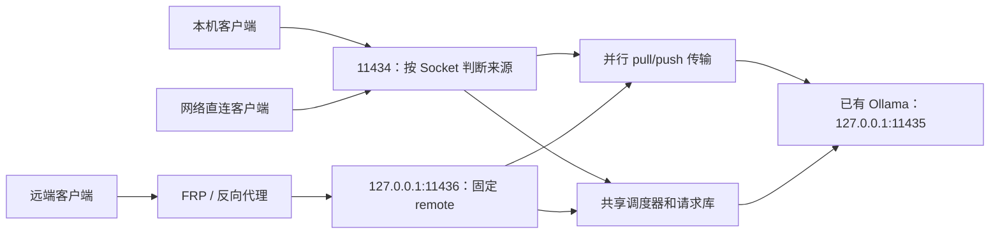

[English](../README.md) | [简体中文](README.zh-CN.md) | [繁體中文](README.zh-TW.md) | [日本語](README.ja.md) | [한국어](README.ko.md) | [Deutsch](README.de.md) | [Français](README.fr.md) | [Español](README.es.md)

<!-- readme:b00 -->

# Ollama Status Service

<!-- readme:b01 -->

**看清 Ollama 机器何时可以接单，让本机用户优先获得下一次执行机会。**

<!-- readme:b02 -->

为已有 Ollama 安装提供 Windows HTTP 网关、后台服务和系统托盘应用。它跟踪请求的执行过程，提供机器可读的状态与帮助，并通过同一个队列调度本机和远端任务。

<!-- readme:b03 -->

**当前版本：1.6.1 · Windows x64 · 离线安装包**

<!-- readme:b04 -->

1.6.1 修复版本摘要、已保存的更新记录和安装完成提示中的语言混用。界面支持八种语言，自动匹配并保存手动选择；自动发现代理，内置适用于 TUN/Fake-IP 网络的本机下载转发入口；修复过时的 Ollama 升级提示和托盘操作时命令窗口闪现。详见[下载网络说明][link1]。托盘还提供官方 Ollama 更新检查与升级：每六小时检查稳定版，验证安装包哈希和发布者签名，拒绝中断活动任务或状态不确定的任务，并在验证原模型和配置后恢复 OSS 接管。详见[Ollama 更新说明][link2]。Windows 安装包见下方链接。

<!-- readme:b05 -->

1.4.0 起在 `/manage` 内置多服务器网页管理器：添加或导入节点、下载或删除模型，以及暂停或继续由服务器持久托管的下载。沿用现有反向代理认证，不新增账号、端口或管理器进程。详见[管理器指南][link3]。

<!-- readme:b06 -->

1.2.5 修复 LocalService 权限不足导致模型列表为空的问题。安装与升级会修复模型目录树的权限，以实际服务账户验证访问，并核对后端和网关的模型列表，全部通过后才报告成功。支持默认 C 盘用户目录中的模型路径，并保留 1.2.4 的并发 `pull`/`push` 修复。

<!-- readme:b07 -->

[1.6.1 发布页][link4] · [Windows ZIP][link5] · [SHA256][link6] · [更新记录][link7] · [源码构建][link8]

<!-- readme:b08 -->

> 从上方发布页下载 `OllamaStatusService-Windows-x64-v1.6.1.zip` 和校验文件，或从源码构建。GitHub 自动生成的“Source code”归档不是可安装的软件包。安装器、托盘、/manage 和 /dashboard 支持简体中文、繁体中文、英文、日文、韩文、德文、法文和西班牙文，可自动匹配语言或保存手动选择；/status 和 /help 翻译显示文字，同时保留协议字段。详见[语言设置][link9]。

<!-- readme:b09 -->

模型 `pull`/`push` 传输绕过推理队列及其超时限制，可以并发执行并持续输出流式进度。`/status` 单独统计这些传输：它们使维护状态显示为 `busy`，但不占用推理执行名额。判断能否开始推理请使用 `can_start_now`。

<!-- readme:b10 -->

## 为什么需要网关？

<!-- readme:b11 -->

模型已安装或已加载，不代表它正在执行请求。`/api/tags` 列出已有模型，`/api/ps` 列出已加载模型，两者都不是请求调度器。本服务观察实际转发的请求，包括流式响应、断线和无法确认完成的情况。

<!-- readme:b12 -->

所有受管理的请求都必须经过网关。直接访问底层 Ollama 端口的任务不在统计范围内。本项目独立于 Ollama，不附带 Ollama、模型、GPU 库或驱动。

<!-- readme:b13 -->

## 主要功能

<!-- readme:b14 -->

- **明确的状态：** `idle`、`busy`、`offline`、`unknown` 和 `stopping`，以及执行中和排队请求的数量、来源与 ID。
- **本机优先且不抢占：** 当前请求先完成；等待中的本机请求排在远端请求之前，同类内部按 FIFO 排序。不为未来批次预留位置。
- **代理专用入口：** FRP、SSH 隧道和反向代理使用 `11436`，固定识别为 `remote`。客户端请求头不能将请求提升为 `local`。
- **自描述 API：** `/help`、`/.well-known/ollama-status-service` 和 `/openapi.json` 说明能力、队列限制及重试规则。
- **直观的托盘反馈：** 彩色图标、队列数量、状态面板、日志与服务控制。退出托盘不会停止后台服务。
- **实用的安装器：** 发现模型路径并显示来源、校验软件包、升级前检查，以及同一个窗口内的进度显示。
- **谨慎的恢复机制：** 执行状态不确定时，将记录持久化到 SQLite，恢复前阻止新任务。请求数据库不保存完整提示词或生成结果。

<!-- readme:b15 -->

| 托盘 | 含义 |
| --- | --- |
| ![空闲][link10] | 空闲 |
| ![忙碌][link11] | 正在执行或有请求排队 |
| ![离线][link12] | 后端不可用 |
| ![未知][link13] | 无法确认完成，需要恢复 |

<!-- readme:b16 -->

## 架构

<!-- readme:b17 -->



<!-- readme:b18 -->

| 端口 | 默认用途 | 来源分类 |
| --- | --- | --- |
| `11434` | IPv4/IPv6 直连网关 | 按真实 Socket 对端判断；本机客户端使用回环地址 |
| `11436` | IPv4 回环代理入口 | 固定为 `remote` |
| `11435` | IPv4 回环 Ollama 后端 | 仅供内部使用，不应绕过网关 |

<!-- readme:b19 -->

两个网关监听入口共用一个进程、生命周期、执行限制和队列。这是请求级调度，不是多机显存拼接。选择哪台机器仍由客户端负责；仅使用标准库的示例见 [`examples/route_request.py`][link14]。

<!-- readme:b20 -->

## 安装或升级

<!-- readme:b21 -->

环境要求：Windows 10/11 x64 或带桌面的 Windows Server、已有 Ollama 和本地模型、Windows PowerShell 5.1、.NET Framework 4.8，以及安装所需的管理员权限。系统必须提供任务计划程序和 Windows 防火墙管理功能。

<!-- readme:b22 -->

1. 下载发布 ZIP 及其 `.sha256.txt` 文件。使用 `Get-FileHash -Algorithm SHA256` 计算 ZIP 的哈希，与提供的校验值比较。
2. 暂停提交新任务，等待执行中和排队中的任务完成。将**整个**压缩包解压到新的文件夹，不要放进已安装的程序目录。
3. 运行 **`Install.exe`**，核对识别出的 Ollama 程序和模型目录，然后确认 Windows UAC 提示。已有安装也使用同一个程序进入升级流程。
4. 打开托盘图标，或访问 `http://127.0.0.1:11434/dashboard`。运行时、依赖和服务包装器已包含在安装包内，安装时无需下载。
5. FRP 或其他同机代理的本地回源改为 `127.0.0.1:11436`，验证请求来源后再恢复客户端提交。

<!-- readme:b23 -->

安装器复用现有 Ollama 和模型，将后端改为 `11435`，并安装网关与后端服务。安装、升级、恢复和停止服务可能中断任务：**不抢占适用于正常调度，不适用于维护操作**。升级在卸载旧版前检查忙碌、排队、未知状态和代理端口冲突。如果旧版卸载后新版安装失败，安装器会报告错误并保留备份，但不承诺自动回滚。

<!-- readme:b24 -->

运行 **`Uninstall.exe`** 可移除本服务并恢复备份的集成设置，原 Ollama 安装和模型保留。中文详细说明见[部署指南][link15]和 [AI 接入指南][link16]。

<!-- readme:b25 -->

模型权限仅向 **LocalService（`S-1-5-19`）** 授予**修改（Modify）**，包括受保护的子目录和文件。修改前记录原规则，在卸载或安装失败时恢复；其他账户、所有者和继承保护保持不变。临时任务会验证真实服务账户的访问能力，检查后移除。显式拒绝或加密仍可能阻止访问，此时报告具体路径的错误。模型目录树不允许目录联接或重解析点，请选择实际目录。

<!-- readme:b26 -->

## FRP 与反向代理设置

<!-- readme:b27 -->

在**每台服务器**现有的 Ollama 代理条目中，只修改本地回源目标：

<!-- readme:b28 -->

```toml
localIP = "127.0.0.1"
localPort = 11436
```

<!-- readme:b29 -->

INI 配置对应 `local_ip` 和 `local_port`。保留原代理名称、类型、公网端口或域名、认证及 TLS 配置，外部客户端 URL 通常不变。下列示例是配置片段，不应整文件替换：[`frpc-ollama.toml`][link17]、[`frpc-ollama.ini`][link18]。

<!-- readme:b30 -->

同机 Nginx、Caddy 和 SSH 隧道也应回源到 `11436`。异机代理需要明确配置可达的绑定地址，并适当限制防火墙访问。此入口接收普通 HTTP，**不支持 PROXY protocol**。

<!-- readme:b31 -->

```powershell
curl.exe --noproxy "*" http://127.0.0.1:11434/help
curl.exe --noproxy "*" http://127.0.0.1:11436/help
```

<!-- readme:b32 -->

检查 `version=1.6.1`，确认两个入口的来源分别为 `request_origin=local` / `remote`，再通过现有公网代理 URL 检查 `/help`。推理期间查看 `/status.active_origin` 和 `requests[].origin`。代理若仍回源到 `11434`，回环转发仍可能被误判为本机任务。

<!-- readme:b33 -->

验收顺序：运行远端 A，排入远端 B，再以正数等待超时排入本机 C。A 必须完整执行，不被中断；随后 C 先于 B 执行。两个排队请求都不能超过各自等待期限和队列容量限制。

<!-- readme:b34 -->

## API 与队列策略

<!-- readme:b35 -->

| 接口 | 用途 |
| --- | --- |
| `GET /status` | 当前状态、就绪情况、执行和排队数量、请求元数据 |
| `GET /help` | 实时限制、能力、来源和客户端接入说明 |
| `GET /healthz` | 网关存活与本次探测的来源；不代表后端就绪 |
| `GET /dashboard` | 浏览器状态面板 |
| `GET /manage` | 内置多服务器和模型管理，沿用反向代理认证 |
| `GET /api/tags`, `GET /api/ps` | 代理 Ollama 的模型列表和已加载模型列表 |

<!-- readme:b36 -->

每个推理请求可设置 `X-Ollama-Queue-Timeout`：`0` 表示忙时立即拒绝，正数表示最多等待的秒数，省略则使用服务器默认值（15 秒）。默认上限为 3600 秒，运行实例的实际限制见 `/help`。推理开始后不会被等待期限截断。调度执行并发为 1（不含 pull/push），最多排队 64 个请求，排队 JSON 数据总量最多 64 MiB。

<!-- readme:b37 -->

```powershell
$body = @{ model='qwen3:8b'; prompt='Hello'; stream=$false } | ConvertTo-Json
Invoke-RestMethod -Uri 'http://127.0.0.1:11434/api/generate' `
  -Method Post -ContentType 'application/json; charset=utf-8' `
  -Headers @{'X-Ollama-Queue-Timeout'='30'} `
  -Body ([Text.Encoding]::UTF8.GetBytes($body)) -TimeoutSec 3700
```

<!-- readme:b38 -->

将示例模型替换为本机已安装的模型。本机请求只有在**实际加入队列后**才获得优先权。忙时零等待请求也可能被拒绝；持续的本机工作负载可能使远端请求一直等到其期限届满。

<!-- readme:b39 -->

`can_start_now` 是状态快照，不是资源预留。安全的自动换机需要同时满足 **HTTP 429/503 + `X-Ollama-Forwarded: false` + JSON `forwarded: false`**。超时、断线或部分输出不能证明任务从未开始；不要静默地把状态不确定的请求在其他机器上重放。本服务不提供跨服务器恰好执行一次的保证。

<!-- readme:b40 -->

## 网络与恢复边界

<!-- readme:b41 -->

**网关不新增身份认证。** 自 1.2.2 起，安装或升级会将本产品 TCP `11434` 的允许规则设置为所有来源、所有本地地址和所有网络配置文件，且限定于随包 Python 程序。原自定义来源限制会备份，但不会自动保留。升级后请检查规则，落实适当的认证、HTTPS 和网络访问控制。`11435` 和 `11436` 默认仅监听回环，不会自动对外开放。

<!-- readme:b42 -->

持久配置与历史记录位于 `%ProgramData%\OllamaStatusService`，程序文件位于 `%ProgramFiles%\OllamaStatusService`。参见 [`config.example.json`][link19]。不提供远程写入配置的 API。

<!-- readme:b43 -->

无法确认请求是否完成时，`unknown` 会阻止接收新任务。只有在可以终止未完成任务时，才使用托盘恢复操作。恢复会先停止并检查后端，再清理不确定记录。Ollama 可能仍在运行时，不要删除数据库。队列载荷保存在内存中，重启后不会重放。

<!-- readme:b44 -->

## 开发与验证

<!-- readme:b45 -->

测试命令见[构建说明][link8]。1.6.1 已通过 18 项原生国际化、11 项网页国际化、18 个隔离 OSS 升级场景、21 项托盘与发行版检查、12 个 Ollama 更新协调场景及恢复附加检查、4 项真实安装器 GUI 检查和 5 项编译后隐藏工作进程检查。此前 1.6.0 的集成回归通过 118 项 Python 测试，其中包括 15 项下载网络和 7 项升级接单保护测试。发布前核对包内哈希、归档完整性、ASCII 文件名及源码和安装包的一致性。1.2.5 还在 C 盘用户目录测试环境中验证了真实 NTFS ACL 修复和 LocalService 访问。历史报告保留 1.2.4 的两项 Ollama CLI 并发检查和 1.2.3 的安装器界面检查。测试不代表每台生产服务器的部署或 GPU/FRP 行为都已验收。详见[验证报告][link20]。

<!-- readme:b46 -->

八种语言的 README 包含相同的章节、表格、示例和运行边界。文档由共享翻译块生成，打包时拒绝缺失或过时的版本。参见 [README 翻译维护说明][link21]。

<!-- readme:b47 -->

公开示例使用占位内容。生产配置、日志，以及原客户端和开发过程的 Word、Markdown 文档均不包含在公开仓库中。

<!-- readme:b48 -->

## 许可证

<!-- readme:b49 -->

本项目尚未选定源码许可证。公开发布不等于普遍授权使用、修改或再分发项目源码。第三方组件的许可声明不适用于本项目自身代码。

<!-- readme:b50 -->

第三方组件保留各自许可证，见 [`licenses/THIRD-PARTY-NOTICES.txt`][link22]。发布包包含 Python 和随包依赖的许可证文件。

[link1]: ../docs/DOWNLOAD-NETWORK.md
[link2]: ../docs/OLLAMA-UPDATES.md
[link3]: ../docs/MANAGE.md
[link4]: https://github.com/ozil56/OllamaStatusService/releases/tag/v1.6.1
[link5]: https://github.com/ozil56/OllamaStatusService/releases/download/v1.6.1/OllamaStatusService-Windows-x64-v1.6.1.zip
[link6]: https://github.com/ozil56/OllamaStatusService/releases/download/v1.6.1/OllamaStatusService-Windows-x64-v1.6.1.zip.sha256.txt
[link7]: ../CHANGELOG.md
[link8]: ../docs/BUILD.md
[link9]: ../docs/LANGUAGES.md
[link10]: ../docs/images/idle.png
[link11]: ../docs/images/busy.png
[link12]: ../docs/images/offline.png
[link13]: ../docs/images/unknown.png
[link14]: ../examples/route_request.py
[link15]: ../Deployment-Guide.txt
[link16]: ../Integration-Guide.txt
[link17]: ../examples/frpc-ollama.toml
[link18]: ../examples/frpc-ollama.ini
[link19]: ../config.example.json
[link20]: ../Verification-Report.txt
[link21]: ../docs/README-TRANSLATIONS.md
[link22]: ../licenses/THIRD-PARTY-NOTICES.txt
