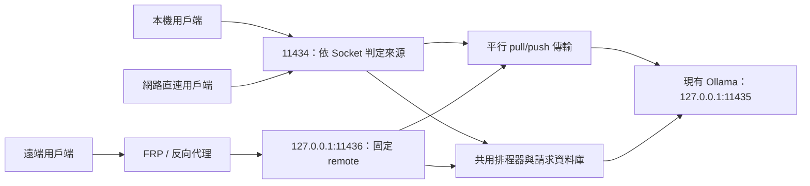

[English](../README.md) | [简体中文](README.zh-CN.md) | [繁體中文](README.zh-TW.md) | [日本語](README.ja.md) | [한국어](README.ko.md) | [Deutsch](README.de.md) | [Français](README.fr.md) | [Español](README.es.md)

<!-- readme:b00 -->

# Ollama Status Service

<!-- readme:b01 -->

**看清 Ollama 機器何時可以接單，讓本機使用者優先獲得下一次執行機會。**

<!-- readme:b02 -->

為已有 Ollama 安裝提供 Windows HTTP 閘道器、背景服務和系統系統匣應用。它跟蹤請求的執行過程，提供機器可讀的狀態與幫助，並透過同一個佇列排程本機和遠端任務。

<!-- readme:b03 -->

**當前版本：1.6.1 · Windows x64 · 離線安裝套件**

<!-- readme:b04 -->

1.6.1 修復版本摘要、已儲存的更新記錄和安裝完成提示中的語言混用。介面支援八種語言，自動匹配並儲存手動選擇；自動發現代理，內建適用於 TUN/Fake-IP 網路的本機下載轉發入口；修復過時的 Ollama 升級提示和系統匣操作時命令視窗閃現。詳見[下載網路說明][link1]。系統匣還提供官方 Ollama 更新檢查與升級：每六小時檢查穩定版，驗證安裝套件雜湊和發行者簽章，拒絕中斷活動任務或狀態不確定的任務，並在驗證原模型和設定後恢復 OSS 接管。詳見[Ollama 更新說明][link2]。Windows 安裝套件見下方連結。

<!-- readme:b05 -->

1.4.0 起在 `/manage` 內建多伺服器網頁管理器：新增或匯入節點、下載或刪除模型，以及暫停或繼續由伺服器持久託管的下載。沿用現有反向代理認證，不新增賬號、埠或管理器程序。詳見[管理器指南][link3]。

<!-- readme:b06 -->

1.2.5 修復 LocalService 權限不足導致模型列表為空的問題。安裝與升級會修復模型目錄樹的權限，以實際服務帳戶驗證存取，並核對後端和閘道器的模型列表，全部透過後才報告成功。支援預設 C 盤使用者目錄中的模型路徑，並保留 1.2.4 的併發 `pull`/`push` 修復。

<!-- readme:b07 -->

[1.6.1 釋出頁][link4] · [Windows ZIP][link5] · [SHA256][link6] · [更新記錄][link7] · [原始碼構建][link8]

<!-- readme:b08 -->

> 從上方釋出頁下載 `OllamaStatusService-Windows-x64-v1.6.1.zip` 和校驗檔案，或從原始碼構建。GitHub 自動生成的“Source code”歸檔不是可安裝的套件。安裝器、系統匣、/manage 和 /dashboard 支援簡體中文、繁體中文、英文、日文、韓文、德文、法文和西班牙文，可自動匹配語言或儲存手動選擇；/status 和 /help 翻譯顯示文字，同時保留協議欄位。詳見[語言設定][link9]。

<!-- readme:b09 -->

模型 `pull`/`push` 傳輸繞過推理佇列及其超時限制，可以併發執行並持續輸出流式進度。`/status` 單獨統計這些傳輸：它們使維護狀態顯示為 `busy`，但不佔用推理執行名額。判斷能否開始推理請使用 `can_start_now`。

<!-- readme:b10 -->

## 為什麼需要閘道器？

<!-- readme:b11 -->

模型已安裝或已載入，不代表它正在執行請求。`/api/tags` 列出已有模型，`/api/ps` 列出已載入模型，兩者都不是請求排程器。本服務觀察實際轉發的請求，包括流式響應、斷線和無法確認完成的情況。

<!-- readme:b12 -->

所有受管理的請求都必須經過閘道器。直接存取底層 Ollama 埠的任務不在統計範圍內。本專案獨立於 Ollama，不附帶 Ollama、模型、GPU 庫或驅動。

<!-- readme:b13 -->

## 主要功能

<!-- readme:b14 -->

- **明確的狀態：** `idle`、`busy`、`offline`、`unknown` 和 `stopping`，以及執行中和排隊請求的數量、來源與 ID。
- **本機優先且不搶佔：** 當前請求先完成；等待中的本機請求排在遠端請求之前，同類內部按 FIFO 排序。不為未來批次預留位置。
- **代理專用入口：** FRP、SSH 隧道和反向代理使用 `11436`，固定識別為 `remote`。用戶端請求頭不能將請求提升為 `local`。
- **自描述 API：** `/help`、`/.well-known/ollama-status-service` 和 `/openapi.json` 說明能力、佇列限制及重試規則。
- **直觀的系統匣回饋：** 彩色圖示、佇列數量、狀態面板、日誌與服務控制。退出系統匣不會停止背景服務。
- **實用的安裝器：** 發現模型路徑並顯示來源、校驗套件、升級前檢查，以及同一個視窗內的進度顯示。
- **謹慎的恢復機制：** 執行狀態不確定時，將記錄持久化到 SQLite，恢復前阻止新任務。請求資料庫不儲存完整提示詞或生成結果。

<!-- readme:b15 -->

| 系統匣 | 含義 |
| --- | --- |
| ![空閒][link10] | 空閒 |
| ![忙碌][link11] | 正在執行或有請求排隊 |
| ![離線][link12] | 後端不可用 |
| ![未知][link13] | 無法確認完成，需要恢復 |

<!-- readme:b16 -->

## 架構

<!-- readme:b17 -->



<!-- readme:b18 -->

| 埠 | 預設用途 | 來源分類 |
| --- | --- | --- |
| `11434` | IPv4/IPv6 直連閘道器 | 按真實 Socket 對端判斷；本機用戶端使用迴環位址 |
| `11436` | IPv4 迴環代理入口 | 固定為 `remote` |
| `11435` | IPv4 迴環 Ollama 後端 | 僅供內部使用，不應繞過閘道器 |

<!-- readme:b19 -->

兩個閘道器監聽入口共用一個程序、生命週期、執行限制和佇列。這是請求級排程，不是多機視訊記憶體拼接。選擇哪臺機器仍由用戶端負責；僅使用標準庫的示例見 [`examples/route_request.py`][link14]。

<!-- readme:b20 -->

## 安裝或升級

<!-- readme:b21 -->

環境要求：Windows 10/11 x64 或帶桌面的 Windows Server、已有 Ollama 和本地模型、Windows PowerShell 5.1、.NET Framework 4.8，以及安裝所需的管理員權限。系統必須提供任務計劃程式和 Windows 防火牆管理功能。

<!-- readme:b22 -->

1. 下載釋出 ZIP 及其 `.sha256.txt` 檔案。使用 `Get-FileHash -Algorithm SHA256` 計算 ZIP 的雜湊，與提供的校驗值比較。
2. 暫停提交新任務，等待執行中和排隊中的任務完成。將**整個**壓縮包解壓到新的資料夾，不要放進已安裝的程式目錄。
3. 執行 **`Install.exe`**，核對識別出的 Ollama 程式和模型目錄，然後確認 Windows UAC 提示。已有安裝也使用同一個程式進入升級流程。
4. 開啟系統匣圖示，或存取 `http://127.0.0.1:11434/dashboard`。執行時、依賴和服務包裝器已包含在安裝套件內，安裝時無需下載。
5. FRP 或其他同機代理的本地回源改為 `127.0.0.1:11436`，驗證請求來源後再恢復用戶端提交。

<!-- readme:b23 -->

安裝器複用現有 Ollama 和模型，將後端改為 `11435`，並安裝閘道器與後端服務。安裝、升級、恢復和停止服務可能中斷任務：**不搶佔適用於正常排程，不適用於維護操作**。升級在解除安裝舊版前檢查忙碌、排隊、未知狀態和代理埠衝突。如果舊版解除安裝後新版安裝失敗，安裝器會報告錯誤並保留備份，但不承諾自動回滾。

<!-- readme:b24 -->

執行 **`Uninstall.exe`** 可移除本服務並恢復備份的整合設定，原 Ollama 安裝和模型保留。中文詳細說明見[部署指南][link15]和 [AI 接入指南][link16]。

<!-- readme:b25 -->

模型權限僅向 **LocalService（`S-1-5-19`）** 授予**修改（Modify）**，包括受保護的子目錄和檔案。修改前記錄原規則，在解除安裝或安裝失敗時恢復；其他帳戶、所有者和繼承保護保持不變。臨時任務會驗證真實服務帳戶的存取能力，檢查後移除。顯式拒絕或加密仍可能阻止存取，此時報告具體路徑的錯誤。模型目錄樹不允許目錄聯接或重解析點，請選擇實際目錄。

<!-- readme:b26 -->

## FRP 與反向代理設定

<!-- readme:b27 -->

在**每臺伺服器**現有的 Ollama 代理條目中，只修改本地回源目標：

<!-- readme:b28 -->

```toml
localIP = "127.0.0.1"
localPort = 11436
```

<!-- readme:b29 -->

INI 設定對應 `local_ip` 和 `local_port`。保留原代理名稱、型別、公網埠或域名、認證及 TLS 設定，外部用戶端 URL 通常不變。下列示例是設定片段，不應整檔案替換：[`frpc-ollama.toml`][link17]、[`frpc-ollama.ini`][link18]。

<!-- readme:b30 -->

同機 Nginx、Caddy 和 SSH 隧道也應回源到 `11436`。異機代理需要明確設定可達的繫結位址，並適當限制防火牆存取。此入口接收普通 HTTP，**不支援 PROXY protocol**。

<!-- readme:b31 -->

```powershell
curl.exe --noproxy "*" http://127.0.0.1:11434/help
curl.exe --noproxy "*" http://127.0.0.1:11436/help
```

<!-- readme:b32 -->

檢查 `version=1.6.1`，確認兩個入口的來源分別為 `request_origin=local` / `remote`，再透過現有公網代理 URL 檢查 `/help`。推理期間檢視 `/status.active_origin` 和 `requests[].origin`。代理若仍回源到 `11434`，迴環轉發仍可能被誤判為本機任務。

<!-- readme:b33 -->

驗收順序：執行遠端 A，排入遠端 B，再以正數等待超時排入本機 C。A 必須完整執行，不被中斷；隨後 C 先於 B 執行。兩個排隊請求都不能超過各自等待期限和佇列容量限制。

<!-- readme:b34 -->

## API 與佇列策略

<!-- readme:b35 -->

| 介面 | 用途 |
| --- | --- |
| `GET /status` | 當前狀態、就緒情況、執行和排隊數量、請求後設資料 |
| `GET /help` | 實時限制、能力、來源和用戶端接入說明 |
| `GET /healthz` | 閘道器存活與本次探測的來源；不代表後端就緒 |
| `GET /dashboard` | 瀏覽器狀態面板 |
| `GET /manage` | 內建多伺服器和模型管理，沿用反向代理認證 |
| `GET /api/tags`, `GET /api/ps` | 代理 Ollama 的模型列表和已載入模型列表 |

<!-- readme:b36 -->

每個推理請求可設定 `X-Ollama-Queue-Timeout`：`0` 表示忙時立即拒絕，正數表示最多等待的秒數，省略則使用伺服器預設值（15 秒）。預設上限為 3600 秒，執行例項的實際限制見 `/help`。推理開始後不會被等待期限截斷。排程執行併發為 1（不含 pull/push），最多排隊 64 個請求，排隊 JSON 資料總量最多 64 MiB。

<!-- readme:b37 -->

```powershell
$body = @{ model='qwen3:8b'; prompt='Hello'; stream=$false } | ConvertTo-Json
Invoke-RestMethod -Uri 'http://127.0.0.1:11434/api/generate' `
  -Method Post -ContentType 'application/json; charset=utf-8' `
  -Headers @{'X-Ollama-Queue-Timeout'='30'} `
  -Body ([Text.Encoding]::UTF8.GetBytes($body)) -TimeoutSec 3700
```

<!-- readme:b38 -->

將示例模型替換為本機已安裝的模型。本機請求只有在**實際加入佇列後**才獲得優先權。忙時零等待請求也可能被拒絕；持續的本機工作負載可能使遠端請求一直等到其期限屆滿。

<!-- readme:b39 -->

`can_start_now` 是狀態快照，不是資源預留。安全的自動換機需要同時滿足 **HTTP 429/503 + `X-Ollama-Forwarded: false` + JSON `forwarded: false`**。超時、斷線或部分輸出不能證明任務從未開始；不要靜默地把狀態不確定的請求在其他機器上重放。本服務不提供跨伺服器恰好執行一次的保證。

<!-- readme:b40 -->

## 網路與恢復邊界

<!-- readme:b41 -->

**閘道器不新增身分驗證。** 自 1.2.2 起，安裝或升級會將本產品 TCP `11434` 的允許規則設定為所有來源、所有本地位址和所有網路設定檔，且限定於隨包 Python 程式。原自定義來源限制會備份，但不會自動保留。升級後請檢查規則，落實適當的認證、HTTPS 和網路存取控制。`11435` 和 `11436` 預設僅監聽迴環，不會自動對外開放。

<!-- readme:b42 -->

持久設定與歷史記錄位於 `%ProgramData%\OllamaStatusService`，程式檔案位於 `%ProgramFiles%\OllamaStatusService`。參見 [`config.example.json`][link19]。不提供遠端寫入設定的 API。

<!-- readme:b43 -->

無法確認請求是否完成時，`unknown` 會阻止接收新任務。只有在可以終止未完成任務時，才使用系統匣恢復操作。恢復會先停止並檢查後端，再清理不確定記錄。Ollama 可能仍在執行時，不要刪除資料庫。佇列載荷儲存在記憶體中，重啟後不會重放。

<!-- readme:b44 -->

## 開發與驗證

<!-- readme:b45 -->

測試命令見[構建說明][link8]。1.6.1 已透過 18 項原生國際化、11 項網頁國際化、18 個隔離 OSS 升級場景、21 項系統匣與發行版檢查、12 個 Ollama 更新協調場景及恢復附加檢查、4 項真實安裝器 GUI 檢查和 5 項編譯後隱藏工作程序檢查。此前 1.6.0 的整合迴歸透過 118 項 Python 測試，其中包括 15 項下載網路和 7 項升級接單保護測試。釋出前核對包內雜湊、歸檔完整性、ASCII 檔名及原始碼和安裝套件的一致性。1.2.5 還在 C 盤使用者目錄測試環境中驗證了真實 NTFS ACL 修復和 LocalService 存取。歷史報告保留 1.2.4 的兩項 Ollama CLI 併發檢查和 1.2.3 的安裝器介面檢查。測試不代表每臺生產伺服器的部署或 GPU/FRP 行為都已驗收。詳見[驗證報告][link20]。

<!-- readme:b46 -->

八種語言的 README 包含相同的章節、表格、示例和執行邊界。文件由共享翻譯塊生成，打包時拒絕缺失或過時的版本。參見 [README 翻譯維護說明][link21]。

<!-- readme:b47 -->

公開示例使用佔位內容。生產設定、日誌，以及原用戶端和開發過程的 Word、Markdown 文件均不包含在公開倉庫中。

<!-- readme:b48 -->

## 許可證

<!-- readme:b49 -->

本專案尚未選定原始碼許可證。公開發布不等於普遍授權使用、修改或再分發專案原始碼。第三方元件的許可宣告不適用於本專案自身程式碼。

<!-- readme:b50 -->

第三方元件保留各自許可證，見 [`licenses/THIRD-PARTY-NOTICES.txt`][link22]。釋出包包含 Python 和隨包依賴的許可證檔案。

[link1]: ../docs/DOWNLOAD-NETWORK.md
[link2]: ../docs/OLLAMA-UPDATES.md
[link3]: ../docs/MANAGE.md
[link4]: https://github.com/ozil56/OllamaStatusService/releases/tag/v1.6.1
[link5]: https://github.com/ozil56/OllamaStatusService/releases/download/v1.6.1/OllamaStatusService-Windows-x64-v1.6.1.zip
[link6]: https://github.com/ozil56/OllamaStatusService/releases/download/v1.6.1/OllamaStatusService-Windows-x64-v1.6.1.zip.sha256.txt
[link7]: ../CHANGELOG.md
[link8]: ../docs/BUILD.md
[link9]: ../docs/LANGUAGES.md
[link10]: ../docs/images/idle.png
[link11]: ../docs/images/busy.png
[link12]: ../docs/images/offline.png
[link13]: ../docs/images/unknown.png
[link14]: ../examples/route_request.py
[link15]: ../Deployment-Guide.txt
[link16]: ../Integration-Guide.txt
[link17]: ../examples/frpc-ollama.toml
[link18]: ../examples/frpc-ollama.ini
[link19]: ../config.example.json
[link20]: ../Verification-Report.txt
[link21]: ../docs/README-TRANSLATIONS.md
[link22]: ../licenses/THIRD-PARTY-NOTICES.txt
